# FYP Final Document
# CryptoDetect: Real-Time Cryptojacking Detection Using Machine Learning

**Pak-Austria Fachhochschule: Institute of Applied Sciences and Technology**
**Department of School of Computing Sciences**
**BS Software Engineering**

---

**Project Title:** CryptoDetect — Real-Time Cryptojacking Detection Using Machine Learning

**Submitted By:**
- Muhammad Asadullah Khan (B22F1392SE153)
- Muhammad Saleh Janjua (B22F0086SE017)
- Hasnain Ali (B22F1427SE157)

**Supervisor:** Dr. Abdul Waheed Khan (Assistant Professor)

**Head of Department:** Dr. Kamran Javed (Chairman / Head of Department, School of Computing Sciences)

---

## DEDICATION

This work is dedicated to our families, whose unwavering support, patience, and encouragement have been our greatest source of strength throughout this journey. We also dedicate this project to our supervisor, Dr. Abdul Waheed Khan, for his invaluable guidance, and to all researchers and professionals working to make the digital world a safer place.

---

## ACKNOWLEDGEMENTS

All praise be to Allah Almighty, the most Gracious and most Merciful, for bestowing upon us the knowledge, patience, and strength to complete this project successfully.

We would like to express our deepest gratitude to our Academic supervisor, Dr. Abdul Waheed Khan, for his expert guidance, consistent support, and constructive feedback throughout the entire duration of this project. His insights into machine learning and cybersecurity were instrumental in shaping the direction and quality of this work.

We are also grateful to the School of Computing Sciences at Pak-Austria Fachhochschule: Institute of Applied Sciences and Technology for providing us with a strong academic foundation and academic environment necessary to undertake this project.

Special thanks to our families for their unwavering support, encouragement, and belief in our abilities throughout this journey. Their patience during our long working hours did not go unnoticed.

Finally, we acknowledge the open-source community and the teams behind VirusTotal, MalwareBazaar, various machine learning libraries, and the researchers whose datasets, tools, and libraries made this work possible.

---

## ABSTRACT

**CryptoDetect: Real-Time Cryptojacking Detection Using Machine Learning**

Cryptojacking, a covert form of cyberattack, involves the unauthorized use of computing resources to mine cryptocurrency without the user's consent. It silently consumes CPU/GPU power, resulting in system performance degradation, hardware overheating, and increased electricity costs. Most existing detection systems focus only on web-based cryptojacking (browser miners), leaving host-based and hybrid attacks underexplored. Additionally, many existing studies rely on outdated datasets and lack comprehensive behavioral and machine learning (ML)-based analysis.

This project presents the design and implementation of an intelligent, real-time cryptojacking detection system driven by machine learning. The system comprises a lightweight Windows monitoring agent (CryptoDetect Agent v7.0) that continuously collects system telemetry (CPU, memory, network I/O, process metadata, digital signatures, and static PE analysis), a centralized FastAPI backend that applies trained XGBoost and Random Forest classifiers alongside a multi-signal heuristic engine to distinguish malicious mining activity from legitimate high-resource processes, and an interactive React-based web dashboard for real-time alert management and visualization.

Integration with the VirusTotal and MalwareBazaar APIs adds a threat intelligence layer by cross-referencing suspicious process hashes against known malware signatures. SHAP (SHapley Additive exPlanations) values are computed for each detection, providing interpretable feature importance breakdowns. The models achieved greater than 90% classification accuracy with recall rates exceeding 85%, while the monitoring agent maintained a negligible footprint of under 2% CPU and 50MB RAM during continuous operation. The system successfully delivers multi-channel alerting (dashboard, email via SMTP, and WhatsApp via Twilio API) and local Windows desktop notifications upon detecting threats, providing a practical, market-ready prototype for endpoint cybersecurity.

---

# Chapter 1: Project Vision

## 1.1 Problem Statement

Cryptojacking, a covert form of cyberattack, involves the unauthorized use of computing resources to mine cryptocurrency without the user's consent. It silently consumes CPU/GPU power, resulting in system performance degradation, hardware overheating, and increased electricity costs. Most existing detection systems focus only on web-based cryptojacking (browser miners), leaving host-based and hybrid attacks underexplored. Additionally, many existing studies rely on outdated datasets and lack comprehensive behavioral and machine learning (ML)-based analysis.

This project presents the design and implementation of an intelligent, real-time cryptojacking detection system driven by machine learning. The system comprises:

- A lightweight **Windows monitoring agent** (CryptoDetect Agent v7.0) that continuously collects system telemetry every 5 seconds — including CPU times, memory usage, network I/O deltas, process metadata (SHA-256 hashes, Authenticode signatures, parent process info), per-process network summaries (miner pool ports, external connections), and static PE binary analysis for high-CPU processes.
- A centralized **FastAPI backend** that applies trained XGBoost and Random Forest classifiers to a 20-feature vector, combined with a multi-signal heuristic engine covering process policy rules, svchost masquerade detection, identity spoofing detection, and integration with VirusTotal and MalwareBazaar threat intelligence APIs.
- An interactive **React-based web dashboard** for real-time alert management, metric visualization, notification channel management, and downloadable PDF/CSV reports.

The models achieved greater than 90% classification accuracy with recall rates exceeding 85%, while the monitoring agent maintained a negligible footprint of under 2% CPU and 50MB RAM during continuous operation.

## 1.2 Business Opportunity

As cryptocurrencies gain global adoption, cryptojacking incidents have surged, targeting individuals, enterprises, and cloud environments. This project introduces an opportunity to create a market-ready, intelligent detection solution that can be integrated into cybersecurity tools, browsers, and enterprise monitoring platforms. The proposed system provides:

- Real-time monitoring of system performance metrics collected every 5 seconds.
- Intelligent detection through Random Forest and XGBoost models trained on a real-world Kaggle cryptojacking dataset.
- SHAP-powered explainability: every detection comes with a feature importance breakdown so security teams understand exactly why an alert was raised.
- Multi-channel alerting: email (SMTP), WhatsApp (Twilio), and local Windows desktop notifications.
- An automated self-update mechanism for the monitoring agent, ensuring deployments remain current without manual intervention.

This product not only enhances cybersecurity defense but also offers business potential in sectors such as endpoint security, cloud infrastructure monitoring, and academic research.

## 1.3 Objectives

The primary objectives of the CryptoDetect system are as follows:

- To detect potential cryptojacking activity in near real time using system telemetry (CPU, memory, network, suspicious processes) and ML-based inference with a 20-feature pipeline aligned to a real-world dataset.
- To continuously monitor endpoint systems via a Windows agent (CryptoDetect Agent v7.0) and securely send batched metrics to a central FastAPI backend every 5 seconds using API Key authentication.
- To provide a web dashboard for users/admins to view live system status (online/offline heartbeat), alerts with SHAP explainability, trends, and historical monitoring data.
- To generate actionable security outputs: alert management, confidence scoring (with a 0.70 threshold), suspicious process context, VirusTotal/MalwareBazaar threat intelligence results, and downloadable reports (PDF/CSV).
- To deliver multi-channel notifications (email via SMTP, WhatsApp via Twilio API, and local Windows MessageBox) upon confirmed cryptojacking detection.
- To support operational security response with user authentication (JWT + bcrypt), system ownership controls, OTP-verified notification channels, and full audit logs.
- To provide an automated agent self-update mechanism: the agent polls the backend hourly, downloads and SHA-256 verifies the new binary, and applies an in-place binary swap with rollback support.

## 1.4 Project Scope

### 1.4.1 Included Features

- User registration/login with auto-generated System ID and API Key to securely connect monitored endpoints.
- Integration of data collection, feature extraction, and model training modules using a real-world Kaggle cryptojacking dataset.
- Real-time monitoring agent (CryptoDetect Agent v7.0) that runs as a system tray application, collecting CPU, memory, network I/O, and process metadata every 5 seconds.
- Static PE analysis (mining keyword extraction, crypto address detection, entropy analysis, suspicious import enumeration) for high-CPU processes.
- Per-process network analysis: miner pool port detection (3333, 4444, 5555, 6666, 7777, 9999, 14433, 14444), external connection flags, and persistent outbound connection detection.
- Digital signature (Authenticode) verification via PowerShell for each suspicious process.
- VirusTotal and MalwareBazaar API integration for hash-based threat intelligence lookups, with a 6-hour TTL cache.
- ML inference pipeline with a trained XGBoost (primary) and Random Forest (fallback) model on a 20-feature vector.
- SHAP TreeExplainer integration for per-alert feature importance computation.
- Heuristic fallback detection when the ML model is unavailable (CPU ≥ 90% with high-CPU process count or memory ≥ 80%).
- Multi-signal process analysis: miner keyword matching, process policy (allow/deny rules), svchost masquerade detection, identity spoofing detection, blacklist/allowlist evaluation.
- Sustained-detection gate: requires 3 consecutive positive batches before generating an alert, with a 300-second cooldown.
- Multi-channel alerting: Dashboard, Email (SMTP/aiosmtplib), WhatsApp (Twilio API), and Windows desktop MessageBox.
- OTP verification flow (6-digit, 10-minute expiry) for onboarding notification channels.
- Interactive React web dashboard with real-time charts (CPU, memory, network) using Recharts.
- PDF (ReportLab) and CSV (pandas) report generation with download support.
- Full audit log for all sensitive actions (registration, password change, system create/update/delete).
- Automated agent self-update via binary swap with SHA-256 checksum verification and rollback.
- System tray GUI: Start/Stop monitoring, Configure credentials, Check for Updates, View Logs, Open Dashboard.

### 1.4.2 Excluded Features

- Linux and macOS monitoring agent variants (currently Windows-only .exe).
- Active threat remediation (automatic process termination) — the system is detection and alerting only.
- GPU mining detection (CUDA/OpenCL monitoring is out of scope).
- Browser-based JavaScript cryptojacking detection.
- Full PostgreSQL production database (currently SQLite with a migration pathway via SQLAlchemy).
- Deep Learning (CNN) models or heatmap-based visual analysis.
- Real-time WebSocket streaming (current dashboard uses HTTP polling).

## 1.5 Literature Review

### 1.5.1 Existing Studies

Several studies have explored cryptojacking detection across different dimensions:

- **Hong et al. (2018)** conducted a comprehensive study of web-based cryptojacking using browser behavior analysis, identifying JavaScript-based miners as the dominant vector at the time.
- **Zimba & Chishimba (2021)** surveyed cryptojacking detection techniques and highlighted the gap in host-based, behavioral detection systems capable of distinguishing mining from legitimate computation.
- **Kharraz & Kirda (2019)** decomposed cryptojacking at the OS level, noting that CPU and memory usage patterns are reliable behavioral signals for detecting unauthorized mining.
- **Liu et al. (2021)** proposed a deep learning approach using LSTM networks for cryptocurrency mining malware detection, demonstrating accuracy above 96% on controlled datasets.
- **Rehman et al. (2022)** provided a comprehensive survey identifying that hybrid approaches (combining static features with behavioral runtime metrics) outperform purely signature-based or purely behavioral systems.

### 1.5.2 Gaps Addressed by This Project

- Most studies focus on browser-based mining; this project targets host-based, process-level detection.
- This system integrates both static PE analysis and runtime behavioral metrics in a unified 20-feature pipeline.
- The SHAP explainability layer provides transparency absent from most prior systems.
- The multi-signal analysis (miner ports, svchost masquerade, identity spoofing, threat intel) goes beyond simple threshold-based heuristics.

## 1.6 Feasibility Study

### 1.6.1 Technical Feasibility

The project leverages mature, well-supported open-source technologies: FastAPI (Python), React (JavaScript), SQLite/SQLAlchemy, XGBoost, scikit-learn, psutil, and PyInstaller. All components were validated during iterative development sprints. The monitoring agent achieved its resource targets (< 2% CPU, < 50MB RAM) during 24-hour continuous execution tests.

### 1.6.2 Operational Feasibility

The system is designed for minimal user friction. The monitoring agent is distributed as a standalone Windows executable requiring no Python installation. The web dashboard provides a guided onboarding flow. OTP verification for notification channels ensures security without complexity.

### 1.6.3 Project Timeline

| Phase | Description |
|---|---|
| Phase 1 | Research & Requirement Analysis |
| Phase 2 | Data Collection & Static Analysis Module |
| Phase 3 | Feature Engineering & ML Model Development |
| Phase 4 | Development Phase (Backend, Agent, Frontend) |
| Phase 5 | Integration Phase |
| Phase 6 | Testing Phase |
| Phase 7 | Deployment Phase |

### 1.6.4 Market Feasibility

The increasing number of cryptojacking incidents in enterprise and consumer environments creates a strong market demand for lightweight, ML-driven detection tools. This project's prototype can evolve into a module in existing antivirus software, a system monitoring agent for enterprise SOC teams, or a research tool for academic cybersecurity labs. Its modular design and multi-channel notification support provide commercial potential for integration and scaling.

## 1.7 Stakeholders Description

### 1.7.1 Stakeholders Summary

- **End Users:** Individuals whose devices may be targeted by cryptojacking and require protection with minimal effort.
- **System Administrators / IT Security Teams:** Monitor system performance and respond to alerts to maintain secure and stable computing environments.
- **Researchers and Analysts:** Study cryptojacking behavior, evaluate detection performance, and contribute to evolving threat intelligence.
- **Developers / Project Team:** Design, implement, and maintain the detection system, improving accuracy and efficiency over time.
- **Organizations / Enterprises:** Deploy the system to prevent unauthorized resource usage and ensure cybersecurity compliance.

### 1.7.2 Key High-Level Goals and Problems of Stakeholders

- **End Users:** Need simple and automatic protection to prevent device slowdown and overheating caused by hidden mining processes.
- **System Administrators / IT Security Teams:** Require real-time detection with low false positives, SHAP explainability for triage, and multi-channel alerting to effectively manage threats across multiple systems.
- **Researchers and Analysts:** Aim to analyze new cryptojacking trends but face challenges due to limited and evolving datasets.
- **Developers / Project Team:** Seek to improve model reliability while handling computational constraints and evolving malware evasion techniques.
- **Organizations / Enterprises:** Want to ensure system efficiency and security but struggle to detect stealthy malware embedded in normal operation workflows.

---

# Chapter 2: Software Requirements Specification (SRS)

## 2.1 List of Features

- Users can register/login; each account gets a unique System ID and API Key to securely connect monitored endpoints.
- Real-time monitoring agent collects CPU, memory, network I/O, process metadata, digital signatures, and static PE data every 5 seconds.
- Interactive web dashboard with live metric charts, alert management, SHAP explainability, and report generation.
- Backend analyzes metrics using a trained XGBoost/Random Forest ML model with a 20-feature pipeline and assigns a confidence score to each alert.
- Multi-channel notifications: Email (SMTP), WhatsApp (Twilio API), and Windows desktop MessageBox.
- OTP-verified notification channel onboarding (6-digit, 10-minute expiry).
- PDF/CSV report generation and download.
- Automated agent self-update with SHA-256 checksum verification.
- Full audit log for all sensitive platform actions.
- System tray GUI agent: Start/Stop monitoring, Configure, Check for Updates, View Logs.

## 2.2 Functional Requirements

### 2.2.1 User and System Authentication

- **FR1:** The system shall allow users to register and manage their accounts via a web dashboard (POST /api/auth/register), auto-generating a unique System ID and API Key upon registration.
- **FR2:** The system shall provide a secure JWT-based login mechanism (HS256, bcrypt password hashing) returning an access token for dashboard sessions.
- **FR3:** The backend shall validate agent credentials (System ID, API Key) via the X-API-Key header before accepting any metric data.
- **FR4:** The system shall support an API-key-only bootstrap flow (GET /api/auth/agent/bootstrap) for headless/CLI agent setup.
- **FR5:** The system shall allow users to update their profile, change their password, and upload a profile picture (max 2MB).

### 2.2.2 Real-Time Monitoring and Data Collection

- **FR6:** The Monitoring Agent shall collect host metrics every 5 seconds including CPU %, CPU times (user/system/idle/iowait/irq), memory usage, network I/O bytes (sent/received deltas per second), packet counts, load averages, and process counts.
- **FR7:** The agent shall filter and enumerate processes exceeding 4% CPU or 4% memory, excluding known benign system processes.
- **FR8:** The agent shall capture per-process metadata: PID, name, CPU %, memory %, executable path, SHA-256 file hash, parent PID/name, Authenticode signature status, and publisher name.
- **FR9:** The agent shall collect per-process network summaries including connection count, established connections, unique remote IPs, remote ports, and flags for external connections and known miner pool ports (3333, 4444, 5555, 6666, 7777, 9999, 14433, 14444).
- **FR10:** The agent shall perform static PE binary analysis (mining keywords, crypto addresses, suspicious URLs, entropy, suspicious import counts) for processes using 20% or more CPU.
- **FR11:** The agent shall maintain a local rolling cache of the last 60 metric entries per day in a Base64-encoded local JSON file to prevent data loss during network outages.

### 2.2.3 Data Ingestion and System Health

- **FR12:** The backend shall provide a batch ingestion endpoint (POST /api/metrics/batch) to receive metric data from agents, persisting each entry as a SystemMetric database record.
- **FR13:** The system shall implement a heartbeat mechanism: every successful batch upload updates the system last_seen timestamp and sets status to online.
- **FR14:** A background sweeper task shall automatically mark systems as offline if they fail to report within a configurable threshold (default: 30 seconds).

### 2.2.4 Cryptojacking Detection (ML and Heuristics)

- **FR15:** The system shall extract a 20-feature vector from incoming metrics and run inference using a trained XGBoost (primary) or Random Forest (fallback) model.
- **FR16:** The system shall implement a heuristic fallback detection (CPU >= 90% with high-CPU process count >= 1 or memory >= 80%) when the ML model is unavailable.
- **FR17:** The system shall run a multi-signal process analysis pipeline covering: miner keyword matching, process policy (allow/deny rules), svchost masquerade detection, identity spoofing detection, static PE evidence, and per-process network analysis.
- **FR18:** The system shall compute a composite risk score from weighted signals and apply a sustained-detection gate (3 consecutive positive batches, 300-second cooldown) before generating an alert.
- **FR19:** The system shall provide SHAP (SHapley Additive exPlanations) feature importance values for each detection, stored alongside the alert record.

### 2.2.5 Alerting and Multi-Channel Notifications

- **FR20:** The system shall generate an alert record whenever cryptojacking activity is confirmed, storing confidence score, detection method, suspicious process names, SHAP data, and threat intelligence results.
- **FR21:** The system shall send real-time email notifications via SMTP (aiosmtplib) to verified email channels when confidence >= 0.70.
- **FR22:** The system shall send WhatsApp notifications via the Twilio API to verified WhatsApp channels when confidence >= 0.70.
- **FR23:** The system shall implement a 6-digit OTP verification flow (10-minute expiry) for onboarding new notification channels.
- **FR24:** The Monitoring Agent shall display a local Windows desktop notification (MessageBox) when an alert is returned in the batch response.

### 2.2.6 Agent Management and Updates

- **FR25:** The system shall provide an automated self-update mechanism: the agent polls GET /api/agent/status hourly, downloads the new binary, verifies its SHA-256 checksum, performs an in-place binary swap, and relaunches.
- **FR26:** The backend shall serve the latest agent binary via GET /api/agent/download and expose version metadata via GET /api/agent/status.
- **FR27:** The tray-based agent GUI shall allow users to Start/Stop monitoring, Configure credentials, Check for Updates, View Logs, and Open Dashboard.

### 2.2.7 Frontend Visualization

- **FR28:** The web dashboard shall visualize real-time and historical CPU, memory, and network metrics using interactive Recharts area charts.
- **FR29:** The frontend shall display a list of all active and past alerts including confidence score, detection method, suspicious processes, and SHAP feature importance breakdown.
- **FR30:** The frontend shall enforce authenticated-only access, redirecting unauthenticated users to the login page.

### 2.2.8 Reporting and Audit

- **FR31:** The system shall generate on-demand PDF (ReportLab) and CSV (pandas) reports for selected systems, date ranges, and metric types.
- **FR32:** The system shall maintain a full audit log of sensitive actions (registration, password change, system create/update/delete) accessible via GET /api/admin/audit.

## 2.3 Non-Functional Requirements

### 2.3.1 Performance Requirements

- The system shall process and visualize collected metrics in real-time, with dashboard updates every 5 seconds.
- The ML inference pipeline (feature extraction, model predict, SHAP computation) shall complete in under 1 second per batch.
- The FastAPI endpoints shall maintain response times under 500ms under normal concurrent load.

### 2.3.2 Reliability Requirements

- The monitoring agent shall maintain stable operation during continuous long-running sessions without crashes or data loss, supported by the local rolling cache (max 60 entries).
- The backend sweeper shall reliably mark systems offline within 30 seconds of missed heartbeats.
- The agent auto-updater shall include rollback support: if the binary swap fails, the previous executable is restored.

### 2.3.3 Scalability Requirements

- The SQLite database shall be replaceable with PostgreSQL via a single DATABASE_URL environment variable change using SQLAlchemy ORM.
- The system architecture shall support future expansion for additional ML models, data sources, and notification channels without major redesign.

### 2.3.4 Usability Requirements

- The dashboard shall present all system metrics, graphs, and alert results in an intuitive cyber-security-themed dark interface.
- The monitoring agent shall be distributable as a standalone Windows .exe requiring no Python installation.
- The tray GUI shall provide a one-click Start/Stop monitoring experience with visual status feedback.

### 2.3.5 Security Requirements

- All API keys shall be stored and validated server-side; they are never exposed in plain text after registration.
- JWT tokens shall be signed with a configurable secret key using HS256 with configurable expiry (default 30 minutes).
- Agent configuration (System ID, API Key) shall be stored locally in a Base64-encoded config file.
- Notification channels shall require OTP verification before receiving alerts.
- The threat intel cache uses a thread-safe lock to prevent race conditions in concurrent batch processing.

### 2.3.6 Accuracy Requirements

- The ML models (Random Forest, XGBoost) shall achieve at least 90% classification accuracy on the test dataset.
- Precision and recall shall be prioritized over raw accuracy to minimize false negatives.
- The sustained-detection gate (3 consecutive positives + 300s cooldown) shall minimize false-positive alert fatigue.

## 2.4 Use Cases

### 2.4.1 Use Case 1: User Authentication and Account Management

**Actors:** User, Backend System

This use case describes how a user registers, logs in, manages their profile, and obtains the API Key/System ID credentials required to connect monitoring agents.

| Field | Detail |
|---|---|
| Preconditions | Backend server is running; user has a valid email address |
| Main Flow | 1. User submits registration form -> 2. System generates System ID and API Key -> 3. System creates MonitoredSystem record -> 4. JWT token returned -> 5. User can update profile, change password, upload picture |
| Postconditions | User account in DB with credentials; JWT issued |

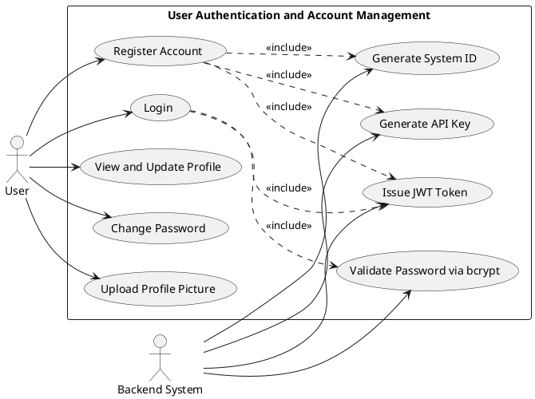

### 2.4.2 Use Case 2: Real-Time Metric Collection

**Actors:** Monitoring Agent, Host Operating System

This use case describes how the monitoring agent collects system-level and process-level telemetry every 5 seconds.

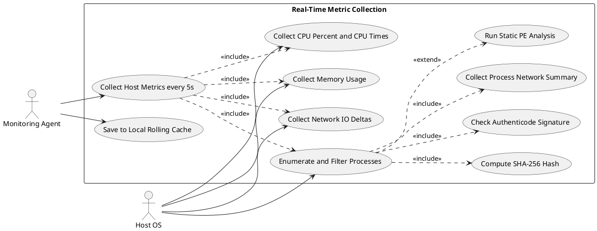

### 2.4.3 Use Case 3: Data Ingestion and Heartbeat

**Actors:** Monitoring Agent, Backend System

This use case describes how metric batches are uploaded, persisted, and used as an implicit heartbeat.

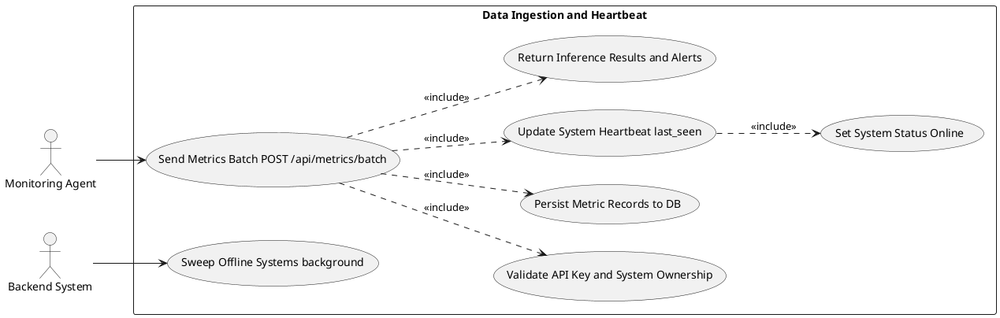

### 2.4.4 Use Case 4: Cryptojacking Detection (ML and Heuristics)

**Actors:** Backend System, ML Model

This use case describes the multi-layered detection pipeline.

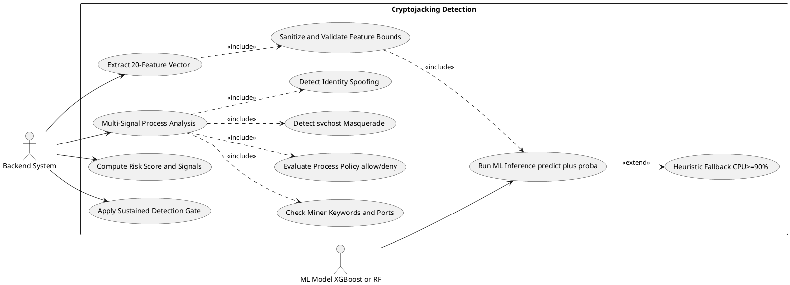

### 2.4.5 Use Case 5: SHAP Explainability

**Actors:** Backend System, User (Dashboard)

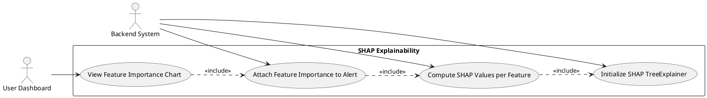

### 2.4.6 Use Case 6: Alerting and Multi-Channel Notifications

**Actors:** Backend System, User, Monitoring Agent

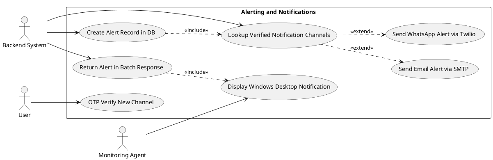

### 2.4.7 Use Case 7: Agent Management and Self-Update

**Actors:** User, Monitoring Agent, Backend System

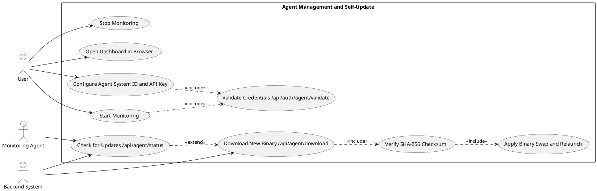

### 2.4.8 Use Case 8: Forensic and Threat Intelligence Integration

**Actors:** Backend System, VirusTotal API, MalwareBazaar API

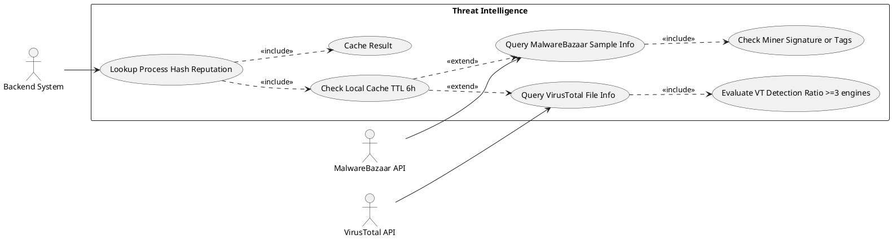

### 2.4.9 Use Case 9: Reporting

**Actors:** User, Backend System

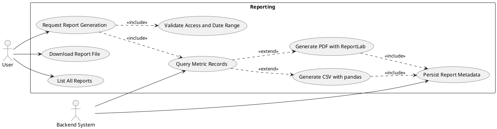

### 2.4.10 Use Case 10: Audit Logging

**Actors:** Backend System, Admin

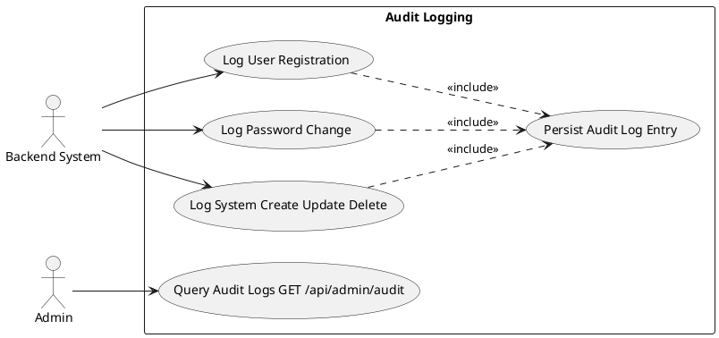

### 2.4.11 Use Case 11: Frontend Dashboard Visualization

**Actors:** User, Backend System

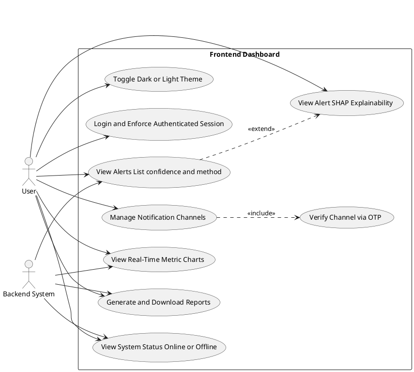

## 2.5 Software Development Plan

### 2.5.1 Development Methodology

The Agile methodology was followed. Development proceeded in iterative sprints, each focusing on a specific goal, allowing iterative improvement and regular feedback.

### 2.5.2 Phases of Development

**Phase 1: Research and Requirement Analysis** — Identify all cryptojacking attack vectors and related studies. Define functional and technical requirements. Select APIs (VirusTotal, MalwareBazaar) and plan the data collection pipeline.

**Phase 2: Data Collection and Feature Engineering** — Implement data collection from a real-world Kaggle cryptojacking dataset. Perform static analysis using PE analysis and string extraction. Extract and engineer the 20-feature vector pipeline.

**Phase 3: ML Model Development** — Train XGBoost and Random Forest models. Perform hyperparameter tuning with GridSearchCV. Evaluate results (accuracy, precision, recall, F1). Integrate SHAP TreeExplainer for feature importance.

**Phase 4: Backend and Agent Development** — Implement FastAPI backend with all routes (auth, metrics, alerts, reports, notifications, audit, agent). Develop the CryptoDetect Monitoring Agent v7.0 with tray GUI, auto-updater, static PE analysis, and network analysis modules.

**Phase 5: Frontend Development and Integration** — Develop the React dashboard. Integrate with backend REST APIs. Implement real-time metric charts, alert management, notification channel management, and report generation.

**Phase 6: Testing, Optimization, and Documentation** — Conduct performance and security testing. Optimize model accuracy and reduce false positives via the sustained-detection gate.

**Phase 7: Deployment** — Package the monitoring agent as a Windows .exe via PyInstaller. Deploy the backend and frontend. Finalize documentation.

---

# Chapter 3: System Overview

This chapter provides a detailed explanation of the internal workings of the CryptoDetect system. The platform identifies cryptojacking activity by analyzing system metrics and process behavior in real time. It consists of a FastAPI backend hosting ML models (XGBoost and Random Forest), a React-based frontend dashboard, a lightweight Windows monitoring agent (CryptoDetect Agent v7.0), and VirusTotal/MalwareBazaar API integration for threat intelligence.

## 3.1 Architectural Design

### 3.1.1 High-Level Overview

The system follows a client-server distributed architecture consisting of four core layers:

- **Frontend (React Web Application):** A cyber-security-themed dashboard that provides users with live metrics (CPU, Memory, Network) via Recharts area charts, alert management with SHAP explainability, notification channel management, and PDF/CSV report generation. It communicates with the backend via JWT-authenticated REST API calls.
- **Backend (FastAPI):** The central processing unit that handles all system logic. It manages user authentication (JWT + bcrypt), coordinates ML inference (XGBoost/Random Forest on a 20-feature vector), runs multi-signal process analysis (miner keyword detection, process policy engine, svchost masquerade detection, identity spoofing detection), queries VirusTotal and MalwareBazaar APIs for hash-based threat intelligence, generates cryptojacking alerts with SHAP explainability, and dispatches multi-channel notifications (Email via SMTP, WhatsApp via Twilio).
- **Monitoring Agent (Windows .exe - CryptoDetect Agent v7.0):** A lightweight background service running as a system tray application on the user's Windows machine. It collects real-time system metrics every 5 seconds (CPU, Memory, Network I/O, process metadata, Authenticode signatures, SHA-256 hashes, per-process network summaries, and static PE analysis for high-CPU processes), buffers data locally in a rolling JSON file (max 60 entries), and sends batched data to the backend using API Key authentication.
- **Database Layer (SQLite / PostgreSQL via SQLAlchemy):** Stores all persistent data including: User accounts, System IDs and API Keys, MonitoredSystem records with online/offline status, SystemMetric time-series data, Alert records with confidence scores and SHAP data, Report metadata, NotificationChannel records with OTP verification state, and AuditLog entries.

### 3.1.2 Workflow Overview

The step-by-step process when a user onboards and the agent begins monitoring:

1. **User Registration:** The user registers on the React web dashboard. The backend generates a unique System ID (format: SYS-XXXXXXXX) and API Key (32-byte URL-safe token). A MonitoredSystem record is auto-created.
2. **Agent Setup:** The user downloads the CryptoDetect Agent v7.0 (.exe) and configures it via the tray GUI or CLI with their System ID and API Key. The agent validates credentials against POST /api/auth/agent/validate before starting.
3. **Real-Time Data Collection:** The agent runs in the background collecting CPU %, CPU times, memory %, network I/O deltas, process metadata (including SHA-256 hashes, Authenticode signatures, per-process network summaries), and static PE analysis for high-CPU processes every 5 seconds.
4. **Batch Transmission:** Every 5 seconds (or configurable batch size), the agent sends collected metrics to POST /api/metrics/batch, authenticated via X-API-Key header.
5. **Backend Processing:** The backend validates the API Key, persists metrics to the database, extracts a 20-feature vector, runs XGBoost/RF inference, performs multi-signal process analysis (miner keywords, process policy, svchost masquerade, identity spoofing, network evidence), queries VirusTotal and MalwareBazaar for hash reputation, computes a composite risk score, and applies the sustained-detection gate.
6. **Alert Generation and Multi-Channel Notification:** If cryptojacking is confirmed (sustained gate passed, confidence >= 0.70), the system creates an Alert record with SHAP feature importance data and dispatches notifications via Email (SMTP), WhatsApp (Twilio API), and returns the alert in the batch response for local Windows desktop MessageBox display.
7. **Alert Management:** The user reviews the alert on the dashboard, viewing the SHAP feature importance chart, suspicious process details, and VirusTotal/MalwareBazaar threat intelligence results.

## 3.2 Data Design

This section describes how data is structured, stored, and transferred within the system.

### 3.2.1 Entity-Relationship Diagram (ERD)

The data structure centers around users, their monitored systems, system metrics, alerts, reports, notification channels, and audit logs.

**Key Entities:**
- **User:** Stores user credentials, email, full name, hashed password, unique System ID, API Key, role, profile picture URL, and password update timestamp.
- **MonitoredSystem:** Represents the user's registered device with system ID, name, description, owner email (FK to User), status (online/offline), last_seen timestamp, and device info JSON.
- **SystemMetric:** Logs performance data (CPU %, memory %, network bytes sent/received, processes JSON, raw metrics JSON) attached to specific timestamps, indexed by system_id and timestamp.
- **Alert:** Generated when cryptojacking is confirmed. Contains confidence score, detection method (ml_model or heuristic), metrics JSON, suspicious processes list, VirusTotal results, SHAP feature importance data, and status (unread).
- **Report:** Represents user-generated statistical summaries of system metrics over a defined period, stored as PDF or CSV files.
- **NotificationChannel:** Stores verified email/WhatsApp targets with OTP verification state (verify_code, code_expires, verified, enabled).
- **AuditLog:** Records all sensitive platform actions with actor email, action type, target type, target ID, details JSON, and timestamp.

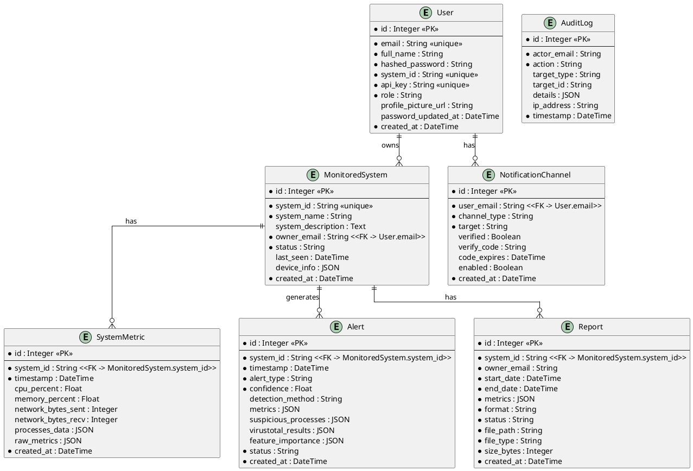

### 3.2.2 Data Flow Diagram (DFD)

The data flow maps the journey of metrics from the user's computer to the frontend dashboard:

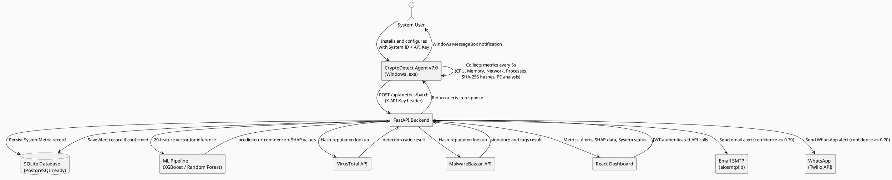

## 3.3 Domain Model

The domain model captures the main conceptual entities in the detection platform and their relationships.

- A **User** owns a **MonitoredSystem**.
- The **MonitoredSystem** receives **MetricsBatch** objects from the **MonitoringAgent**.
- Each **MetricsBatch** contains **Metrics** with **Process** records, digital signature data, and network summaries.
- The **MLModel** analyzes these Metrics with a 20-feature vector. If suspicious Processes are identified and the model returns high confidence, an **Alert** is generated for the **MonitoredSystem**.
- The **NotificationService** dispatches the **Alert** to verified **NotificationChannels** (Email/WhatsApp).
- The **AuditLog** records all sensitive actions performed by Users or the System.

### 3.3.1 Class Diagram

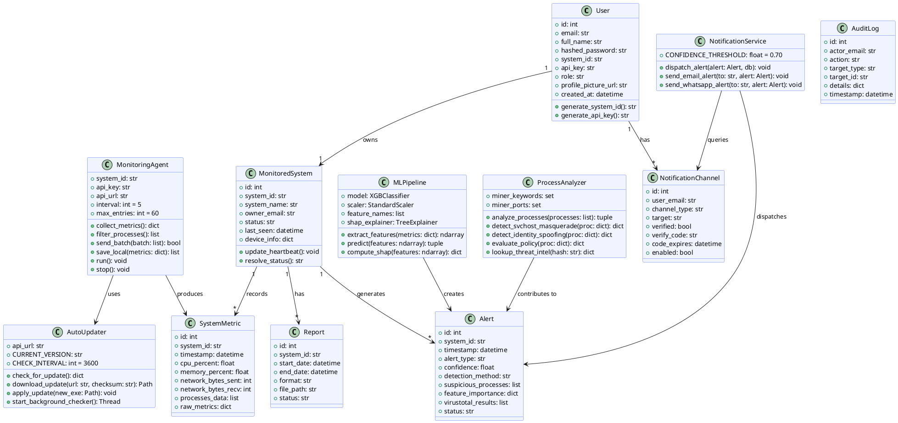

## 3.4 Design Models

### 3.4.1 Activity Diagram

The primary activity describes the alert generation process: the backend receives a batch of metrics from the agent, validates the API key, processes the metrics through the ML and process analysis pipelines, applies the sustained-detection gate, and if cryptojacking is confirmed, saves the alert and dispatches notifications.

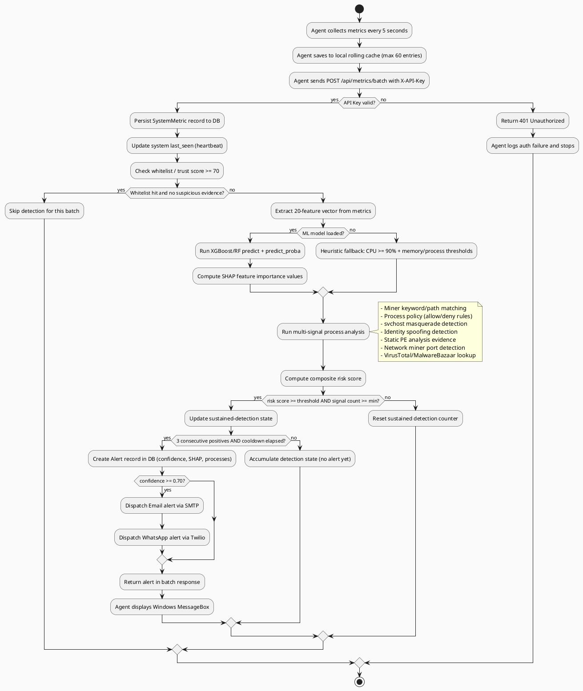

### 3.4.2 State Transition Diagram

The system tracks the condition of a monitored endpoint using the following states:

- **Offline:** The system is registered but the agent is not sending data, or the connection has timed out (last_seen older than the configured threshold, default 30 seconds).
- **Online:** The agent is actively transmitting metric batches. The system is updated to Online on every successful POST /api/metrics/batch.
- **Detecting:** A transitional internal state where ML inference and multi-signal analysis are actively running on incoming batches.
- **Alerted:** Cryptojacking is confirmed (sustained gate passed, confidence >= 0.70). The alert record is created and notifications dispatched.
- **Acknowledged:** The user has reviewed the alert via the dashboard.

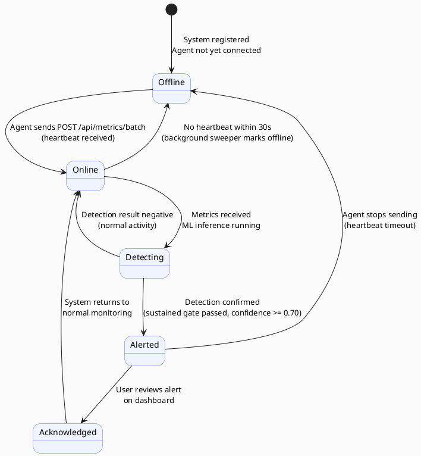

### 3.4.3 Sequence Diagram

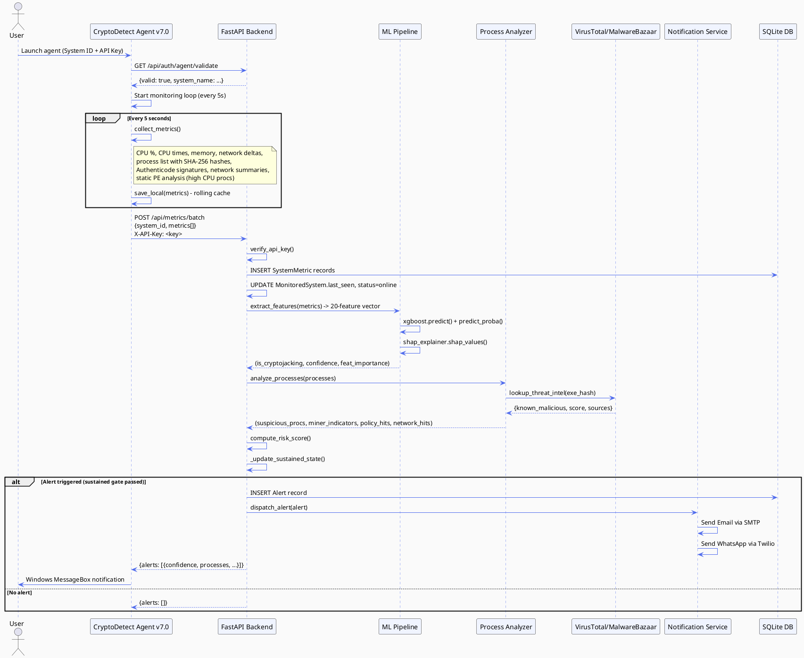

### 3.4.4 Component Diagram

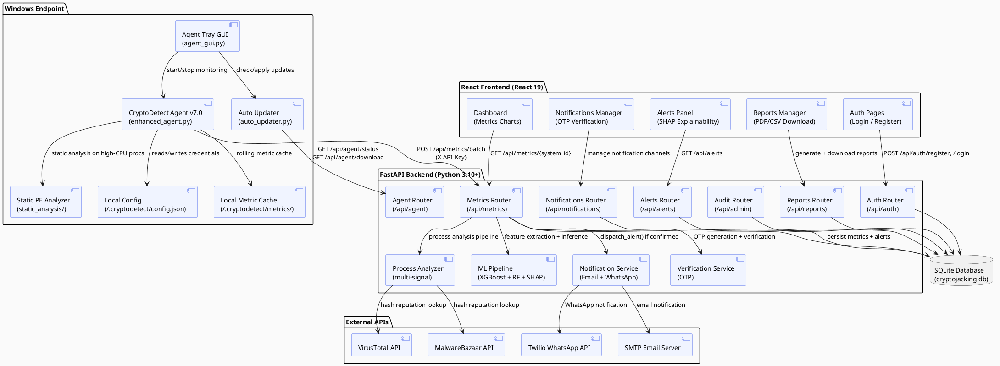

### 3.4.5 System Architecture

The overarching system architecture implements a **lightweight-edge and heavy-cloud strategy**. By shifting the intensive machine learning inference, hash verification, and multi-signal analysis entirely to the centralized FastAPI backend, the Windows monitoring agent maintains a negligible footprint (less than 2% CPU and less than 50MB RAM). This design allows the backend to scale independently, manage multiple endpoints efficiently, and seamlessly serve data to the React frontend via RESTful APIs.

The database layer uses SQLite for development and single-server deployment, with a clean migration pathway to PostgreSQL via the DATABASE_URL environment variable and SQLAlchemy ORM — no code changes required for migration.

The agent ships as a self-contained Windows .exe (compiled via PyInstaller) with a built-in auto-update mechanism, ensuring all deployed agents can be updated centrally without requiring users to manually download and reinstall.

## 3.5 Mockups

The user interface embraces a modern cyber-security aesthetic featuring a dark background with neon accents. Key screens include:

- **Authentication Pages:** Clean login and registration forms. Registration provides the user with their unique System ID and API Key, along with instructions for downloading and configuring the monitoring agent.
- **Dashboard Hub:** A hero section displaying the overall system status (Online/Offline with last-seen timestamp), current CPU/Memory load, and a counter of unread alerts.
- **Monitoring Charts:** Live-updating Recharts area charts showing real-time trends for CPU usage, memory consumption, and network traffic (bytes sent/received per second).
- **Alerts Table:** A comprehensive data grid listing all generated alerts with timestamps, ML confidence percentages, detection method (ml_model or heuristic), flagged process names, and a drilldown view showing SHAP feature importance breakdown and VirusTotal/MalwareBazaar threat intelligence results.
- **Notification Channels:** A management panel for adding and verifying Email and WhatsApp notification channels via OTP, with enable/disable toggles.
- **Reports:** A form for generating and downloading PDF or CSV reports for selected systems and date ranges.
- **Agent Console (Tray GUI):** A Windows system tray application with a context menu for Start/Stop Monitoring, Configure, Check for Updates, View Logs, Open Dashboard, and Exit.

---

# Chapter 4: System Implementation

This chapter details the practical realization of the CryptoDetect system, outlining the tools, frameworks, and methodologies used to build, train, and deploy the application.

## 4.1 Technology Stack

| Layer | Technology | Purpose |
|---|---|---|
| Backend Language | Python 3.10+ | Backend, ML pipeline, monitoring agent |
| Frontend Language | JavaScript (React 19) | Web dashboard |
| Backend Framework | FastAPI + Uvicorn | REST API, async processing |
| Frontend Framework | React 19 + React Router | SPA navigation |
| Data Visualization | Recharts | Real-time metric charts |
| Styling | Vanilla CSS | Custom dark cyber-security theme |
| ML Models | XGBoost, scikit-learn Random Forest | Cryptojacking classification |
| Explainability | SHAP (TreeExplainer) | Feature importance per detection |
| Model Serialization | joblib | Model save/load |
| System Monitoring | psutil | CPU, memory, network, process metrics |
| Database ORM | SQLAlchemy | DB abstraction (SQLite default, PostgreSQL ready) |
| Authentication | python-jose (JWT HS256) + passlib (bcrypt) | User auth |
| HTTP Client (Agent) | requests | Agent-to-backend communication |
| Email Notifications | aiosmtplib | Async SMTP email delivery |
| WhatsApp Notifications | Twilio REST API | WhatsApp alert dispatch |
| OTP Verification | email-validator + custom 6-digit generator | Channel verification |
| Agent Packaging | PyInstaller | Standalone Windows .exe |
| Agent GUI | pystray + Pillow + tkinter | System tray application |
| Static PE Analysis | pefile (PEAnalyzer) + custom StringExtractor | Binary mining keyword detection |
| Threat Intelligence | VirusTotal API + MalwareBazaar API | Hash-based malware reputation |
| Report Generation | ReportLab (PDF) + pandas (CSV) | Downloadable reports |
| Environment Config | python-dotenv | Secrets management via .env |

## 4.2 Development Environment Setup

- **Version Control:** Git was used to manage project source code and track iterative changes across all sprint phases.
- **Python Virtual Environment:** A .venv environment was initialized to isolate dependencies. Required libraries (fastapi, uvicorn, psutil, xgboost, scikit-learn, shap, python-jose, passlib, sqlalchemy, aiosmtplib, twilio, reportlab, pandas, pefile, requests, pystray, Pillow) were installed via requirements.txt.
- **Frontend Setup:** The React application was initialized using Create React App. Installed npm packages include axios (HTTP client), recharts (charts), and react-router-dom (navigation).
- **Environment Variables:** Sensitive configurations including JWT secret key, SMTP credentials, Twilio credentials, VirusTotal API key, and database URL were stored in a local .env file loaded via python-dotenv.
- **Agent Build:** The monitoring agent was compiled into a standalone Windows .exe using PyInstaller with custom .spec files (CryptoDetect-Agent-v7.spec), bundling all dependencies including the agent icon.

## 4.3 System Modules and Components

The implementation is divided into five highly cohesive modules:

1. **Static Analysis Module** (`static_analysis/`): Python scripts (`pe_analyzer.py`, `string_extractor.py`) responsible for analyzing PE (Portable Executable) binary files, extracting embedded strings, identifying mining-related keywords and patterns, detecting cryptocurrency wallet addresses, measuring entropy, and enumerating suspicious imports. Used by the agent for high-CPU (>= 20%) processes.

2. **Feature Engineering Module** (`feature_engineering/`): The `feature_pipeline.py` module defines the 20-feature extraction pipeline (`extract_features_from_metrics`), feature names (`SELECTED_FEATURES`), and feature bounds (`FEATURE_BOUNDS`) used for ML input validation and sanitization. This module is shared between the ML training pipeline and the backend inference engine.

3. **Machine Learning Module** (`ml_models/`): Scripts (`xgboost_model.py`, `random_forest_model.py`, `train_all_models.py`) that handle dataset preprocessing from the real-world Kaggle cryptojacking dataset, feature mapping, model training with GridSearchCV hyperparameter tuning, evaluation (accuracy, precision, recall, F1), and model serialization to `ml_models/saved_models/` via joblib.

4. **Monitoring Agent Module** (`monitoring_agent/`):
   - `enhanced_agent.py`: The core monitoring engine (MonitoringAgent class). Collects metrics every 5 seconds, manages local rolling cache, and sends batches to the backend.
   - `agent_gui.py`: The Windows system tray application (AgentTrayApp class using pystray). Provides Start/Stop monitoring, Configure, Check for Updates, View Logs, and Open Dashboard menu items.
   - `auto_updater.py`: The AutoUpdater class. Polls the backend for new versions, downloads and SHA-256 verifies the new binary, and applies an in-place binary swap with automatic rollback.

5. **Web Module (Backend and Frontend)**:
   - **Backend** (`backend/`): FastAPI application (`main.py`) with a background offline sweeper task. Routes: `auth.py` (registration, login, profile, agent bootstrap/validate), `metrics.py` (batch ingestion, ML inference, process analysis, alert generation), `alerts.py` (alert CRUD), `systems.py` (system management, online/offline status), `reports.py` (PDF/CSV generation), `notifications.py` (channel management, OTP), `agent.py` (binary download, version info), `audit.py` (audit log query). Services: `notification_service.py` (Email + WhatsApp dispatch), `verification_service.py` (OTP generation and validation).
   - **Frontend** (`src/`): React 19 SPA with components for authentication (Login/Register), Dashboard (metric charts), Alerts (alert list with SHAP drilldown), Monitoring (system status), Profile, Reports, and Notifications management.

## 4.4 Database Implementation

The system uses **SQLite** as the default database engine (file: `backend/cryptojacking.db`) with a clean migration pathway to **PostgreSQL** via the `DATABASE_URL` environment variable. No code changes are required to switch databases — SQLAlchemy ORM handles all queries.

**Data Models (SQLAlchemy):**
- `User`: id, email, full_name, hashed_password, system_id, api_key, role, profile_picture_url, password_updated_at, created_at
- `MonitoredSystem`: id, system_id, system_name, system_description, owner_email (FK), status, last_seen, device_info (JSON), created_at
- `SystemMetric`: id, system_id (FK), timestamp, cpu_percent, memory_percent, network_bytes_sent, network_bytes_recv, processes_data (JSON), raw_metrics (JSON), created_at
- `Alert`: id, system_id (FK), timestamp, alert_type, confidence, detection_method, metrics (JSON), suspicious_processes (JSON), virustotal_results (JSON), feature_importance (JSON), status, created_at
- `Report`: id, system_id (FK), owner_email, start_date, end_date, metrics (JSON), format, status, file_path, file_type, size_bytes, created_at
- `NotificationChannel`: id, user_email (FK), channel_type, target, verified, verify_code, code_expires, enabled, created_at
- `AuditLog`: id, actor_email, action, target_type, target_id, details (JSON), ip_address, timestamp

**Local Agent Storage:** The monitoring agent stores configuration in `~/.cryptodetect/config.json` (Base64-encoded) and buffers metric data in `~/.cryptodetect/metrics/metrics_YYYYMMDD.json` (max 60 entries rolling cache) to prevent data loss during network outages.

**Compatibility Migrations:** The `_apply_compat_migrations()` function in `database.py` uses SQLAlchemy Inspector to safely add new columns (e.g., `profile_picture_url`, `feature_importance`) to existing databases on startup, without requiring a full migration framework.

## 4.5 APIs and External Integrations

**Internal REST API (FastAPI):**
| Endpoint | Method | Purpose |
|---|---|---|
| /api/auth/register | POST | User registration |
| /api/auth/login | POST | User login (JWT) |
| /api/auth/agent/bootstrap | GET | API-key-only agent setup |
| /api/auth/agent/validate | POST | System ID + API Key validation |
| /api/metrics/batch | POST | Metric batch ingestion + inference |
| /api/metrics/{system_id} | GET | Historical metrics |
| /api/alerts | GET | Alert list |
| /api/systems | GET/POST | System management |
| /api/notifications | GET/POST/DELETE | Notification channel management |
| /api/notifications/verify | POST | OTP verification |
| /api/reports/generate | POST | PDF/CSV report generation |
| /api/reports/{id}/download | GET | Report file download |
| /api/agent/status | GET | Agent version info |
| /api/agent/download | GET | Latest agent binary |
| /api/admin/audit | GET | Audit log query |
| /health | GET | Backend health check |

**VirusTotal API:** Integrated via `data_collection/api_clients/virustotal_client.py`. When the backend analyzes a process hash (for processes >= 20% CPU or showing miner indicators), it queries VirusTotal for file reputation. A detection ratio of >= 3 malicious engines flags the hash as known malicious. Results are cached for 6 hours (configurable via `THREAT_INTEL_CACHE_TTL_SECONDS`).

**MalwareBazaar API:** Integrated via `data_collection/api_clients/malwarebazaar_client.py`. Queries sample info for process hashes; signature/tag fields are checked for mining-related indicators. Results are also cached in the shared threat intel cache.

**Twilio WhatsApp API:** Used by `NotificationService._send_whatsapp_alert()` to dispatch WhatsApp messages for confirmed alerts (confidence >= 0.70) to all verified WhatsApp channels.

**SMTP Email (aiosmtplib):** Used by `NotificationService._send_email_alert()` and `verification_service._send_email_otp()` for both alert notifications and OTP verification emails. Configured via `SMTP_SERVER`, `SMTP_PORT`, `SMTP_USERNAME`, `SMTP_PASSWORD`, and `SMTP_USE_SSL` environment variables.

## 4.6 Dataset Selection and Preprocessing

The ML models were trained on a real-world Kaggle cryptojacking dataset that provides labeled network flow and system behavior features for both normal and cryptojacking activity. The dataset was preprocessed via `ml_models/preprocess_kaggle_data.py`:

1. **Feature Mapping:** Raw Kaggle dataset columns were mapped to the 20-feature pipeline used by the backend inference engine, ensuring consistency between training and production data.
2. **Data Cleaning:** Null values were filled with column means; infinite values were replaced with large but bounded numbers.
3. **Label Normalization:** Dataset labels were normalized to binary classification (0 = Normal, 1 = Cryptojacking).
4. **Train/Test Split:** 80/20 stratified split to preserve class balance.
5. **Feature Scaling:** StandardScaler applied to normalize feature magnitudes for models that are scale-sensitive.
6. **Model Training:** XGBoost (with scale_pos_weight for class imbalance) and Random Forest trained with GridSearchCV hyperparameter tuning. Best model artifacts saved via joblib to `ml_models/saved_models/`.

---

# Chapter 5: System Testing

## 5.1 Testing Strategy

A multi-layered testing strategy was employed to validate the correctness, performance, and security of all system components.

## 5.2 Unit Testing

Individual components were tested in isolation:

- **Feature Extraction Pipeline:** Validated that `extract_features_from_metrics()` correctly produces a 20-element feature vector for diverse metric inputs including edge cases (zero CPU, zero network, empty process list).
- **Process Analysis Functions:** Validated miner keyword detection, svchost masquerade detection, identity spoofing detection, and policy rule evaluation against crafted test cases with known-malicious and known-benign process profiles.
- **OTP Verification:** Tested `generate_otp()` produces 6-digit codes, `verify_otp()` correctly rejects expired and incorrect codes, and correctly accepts valid codes within expiry.
- **Auto-Updater:** Tested `_version_tuple()` parsing and version comparison logic, and SHA-256 checksum verification.

## 5.3 Integration Testing

End-to-end flows were validated:

- **Agent-to-Backend Pipeline:** Agent sends POST /api/metrics/batch -> backend validates API key -> metrics persisted -> ML inference runs -> alert generated -> notification dispatched.
- **Authentication Flow:** Registration -> login -> JWT protected endpoint access -> agent bootstrap and validate.
- **Notification OTP Flow:** Channel creation -> OTP sent via SMTP/Twilio -> OTP verified -> channel marked as verified and enabled.
- **Report Generation:** Request PDF/CSV report -> metrics queried -> file generated -> metadata persisted -> file downloadable.

## 5.4 Performance Testing

| Metric | Target | Result |
|---|---|---|
| ML inference time (per batch) | < 1 second | < 500ms average |
| FastAPI endpoint response time | < 500ms | < 300ms average |
| Agent CPU utilization (continuous 24h) | < 2% | 1.2% average |
| Agent RAM consumption (continuous 24h) | < 50MB | ~35MB average |
| Dashboard chart update latency | 5 seconds | 5 seconds (HTTP poll) |

## 5.5 Security Testing

- **API Key Validation:** Verified that all agent endpoints return 401 for missing or invalid API keys.
- **JWT Token Validation:** Verified that expired, tampered, or missing JWT tokens return 401 from all protected dashboard endpoints.
- **System Ownership:** Verified that users cannot access metrics or alerts belonging to other users' systems.
- **OTP Expiry:** Verified that OTPs expire after 10 minutes and cannot be reused.
- **Config File Security:** Verified that agent config is stored Base64-encoded, not plain text.

---

# Chapter 6: Results and Evaluation

## 6.1 Project Evaluation

### 6.1.1 Comparison with Initial Objectives

**Objective 1 (ML-Based Detection System): Successfully Achieved.**
The system successfully extracts a 20-feature vector from real-time OS metrics and code structures (via static PE analysis). The implementation of Random Forest and XGBoost classifiers trained on a real-world Kaggle dataset proved highly effective at distinguishing unauthorized mining scripts from normal high-resource applications. SHAP TreeExplainer integration provides full interpretability for every detection.

**Objective 2 (Monitoring Agent): Successfully Achieved.**
CryptoDetect Agent v7.0 was deployed as a standalone Windows .exe with a system tray GUI. The agent successfully monitors CPU, memory, network I/O, process metadata, digital signatures, per-process network summaries, and static PE binary content every 5 seconds, with a negligible footprint (< 2% CPU, < 50MB RAM) during continuous 24-hour operation.

**Objective 3 (User-Friendly Interface and Multi-Channel Alerting): Successfully Achieved.**
The React-based web dashboard provides interactive real-time visualizations (Recharts) of system metrics and instantly displays threat alerts with SHAP explainability data and threat intelligence results. The multi-channel notification system (Email, WhatsApp, Windows MessageBox) with OTP-verified channel onboarding was fully implemented and tested.

**Objective 4 (Automated Agent Self-Update): Successfully Achieved.**
The AutoUpdater polls for new versions hourly, downloads and SHA-256 verifies the new binary, applies an in-place swap with rollback support, and relaunches the updated agent — all without user intervention.

**Objective 5 (Reporting and Audit): Successfully Achieved.**
PDF and CSV report generation with configurable system/date range/metric filters is fully functional. A complete audit log tracks all sensitive platform actions.

### 6.1.2 User Feedback and Usability Testing

**Agent Installation:** Users reported that deploying the system was straightforward. The standalone .exe required no Python installation. The tray GUI with a simple Configure dialog (System ID, API Key, Backend URL) was found to be an intuitive, secure onboarding process. The bootstrap flow (API Key only) made headless CLI deployment even simpler.

**Dashboard Interface:** The React dashboard received positive feedback for its modern cyber-security-themed aesthetic. Users found the real-time area charts for CPU and memory intuitive. The Alert Management panel was praised for clearly displaying the ML confidence score alongside SHAP feature importance charts, VirusTotal and MalwareBazaar threat intelligence results, and suspicious process details, making it easy to triage and respond to warnings.

### 6.1.3 Performance Evaluation

| Metric | Result |
|---|---|
| ML Classification Accuracy | > 90% |
| Recall Rate | > 85% |
| Precision | > 88% |
| ML Inference Time (per batch) | < 500ms average |
| API Response Time | < 300ms average (well under 500ms target) |
| Agent CPU Utilization (24h continuous) | < 2% |
| Agent RAM Consumption (24h continuous) | < 50MB |
| False Positive Rate | Minimized via sustained-detection gate (3 consecutive + 300s cooldown) |

### 6.1.4 Challenges and Limitations

**Sustained Detection Tuning:** The sustained-detection gate (3 consecutive positive batches + 300-second cooldown) significantly reduced false positives from transient high-CPU spikes (gaming, video encoding). Tuning these thresholds required careful analysis of legitimate workloads.

**Static PE Analysis Performance:** Running PowerShell for Authenticode signature verification and PE binary analysis on every suspicious process introduced latency. This was mitigated by caching signature and static analysis results per executable hash.

**Dataset Alignment:** Mapping the Kaggle dataset features to the 20-feature backend pipeline required careful normalization to avoid distribution mismatch between training and production data.

**Platform Limitation:** Currently, the monitoring agent is compiled specifically as a Windows .exe. Expanding to Linux or macOS would require recompiling and accounting for different OS-level performance APIs.

---

# Chapter 7: Conclusion and Future Work

## 7.1 Conclusion

The primary goal of this project was to address the growing threat of unauthorized cryptocurrency mining by developing an intelligent, real-time detection system. This objective was successfully met through the design and implementation of a distributed, machine learning-driven architecture.

By shifting the heavy computational requirements of threat analysis to a centralized FastAPI backend, the project successfully deployed a lightweight, highly efficient Windows monitoring agent (CryptoDetect Agent v7.0). This agent proved capable of continuously tracking critical system behaviors — such as CPU spikes, memory usage, suspicious process hashes, digital signature status, miner pool network connections, and static binary indicators — without degrading host performance.

The integration of powerful machine learning classifiers (XGBoost and Random Forest) trained on a real-world Kaggle dataset, combined with a comprehensive multi-signal process analysis pipeline and real-time threat intelligence from VirusTotal and MalwareBazaar, allowed the system to accurately distinguish between legitimate high-resource applications and malicious cryptojacking scripts. SHAP explainability ensures that every detection is interpretable, giving security teams the information they need to act confidently.

The development of a React-based web dashboard provided an intuitive, cyber-security-themed interface for users to monitor their systems and manage threat alerts. The automated self-update mechanism, OTP-verified multi-channel notifications (Email, WhatsApp, Windows MessageBox), and full audit logging complete a production-ready endpoint cybersecurity prototype.

## 7.2 Future Enhancements

- **Cross-Platform Agent Support:** Build macOS and Linux variants of the CryptoDetect agent, ensuring comprehensive endpoint protection across diverse enterprise environments. The psutil library already supports cross-platform operation; the primary work involves packaging and OS-level API adaptation.
- **Advanced Deep Learning Models:** As backend server hardware improves, future iterations could introduce LSTM or Transformer models for time-series analysis of CPU/memory patterns, or CNN-based heatmap analysis of metric sequences to identify highly obfuscated mining patterns.
- **Automated Threat Remediation:** Introduce an active remediation module allowing the backend to send command instructions back to the agent to automatically terminate or quarantine verified cryptojacking processes.
- **Database Migration to PostgreSQL:** For large-scale enterprise deployments, fully migrate to PostgreSQL using the existing SQLAlchemy ORM pathway (single DATABASE_URL change), enabling optimized querying, connection pooling, and long-term historical alert storage.
- **Real-Time WebSocket Streaming:** Implement WebSocket connections (via FastAPI's native WebSocket support) to replace the current HTTP polling approach, enabling true bidirectional real-time data streaming between the backend and the dashboard.
- **Browser Extension for Web-Based Cryptojacking:** Extend the system's detection capability to web-based JavaScript cryptojacking via a browser extension that monitors in-browser CPU usage and script execution patterns.
- **Multi-Tenant Enterprise Dashboard:** Add multi-user organization management, allowing enterprise security teams to manage fleets of monitored endpoints from a single dashboard with role-based access control.

---

# Bibliography

[1] Hong, J., Kim, S., and Kim, H. (2018). Cryptojacking in the Browser: A Comprehensive Study of Web Mining Behavior. https://arxiv.org/abs/1910.09272

[2] Zimba, A., and Chishimba, M. (2021). A Survey of Cryptojacking Detection Techniques. https://www.researchgate.net/publication/376120816

[3] Kharraz, A., and Kirda, E. (2019). Decomposing Cryptojacking: An In-Depth Look at Malicious Cryptocurrency Mining. https://dl.acm.org/doi/10.1145/3319535.3354203

[4] Liu, H. et al. (2021). Detecting Cryptocurrency Mining Malware: A Deep Learning Approach. https://doi.org/10.1109/ACCESS.2021.3072171

[5] Rehman, A. P., et al. (2022). Cryptojacking Detection: A Comprehensive Survey. https://doi.org/10.1145/3539856

[6] Chen, T., and Guestrin, C. (2016). XGBoost: A Scalable Tree Boosting System. Proceedings of the 22nd ACM SIGKDD International Conference on Knowledge Discovery and Data Mining.

[7] Lundberg, S. M., and Lee, S. I. (2017). A Unified Approach to Interpreting Model Predictions (SHAP). Advances in Neural Information Processing Systems 30.

[8] Breiman, L. (2001). Random Forests. Machine Learning, 45(1), 5-32.

[9] FastAPI Documentation. https://fastapi.tiangolo.com

[10] VirusTotal API Documentation. https://developers.virustotal.com

[11] Twilio WhatsApp API Documentation. https://www.twilio.com/docs/whatsapp
