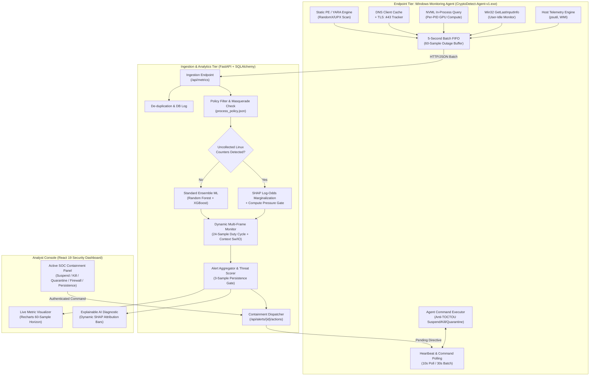
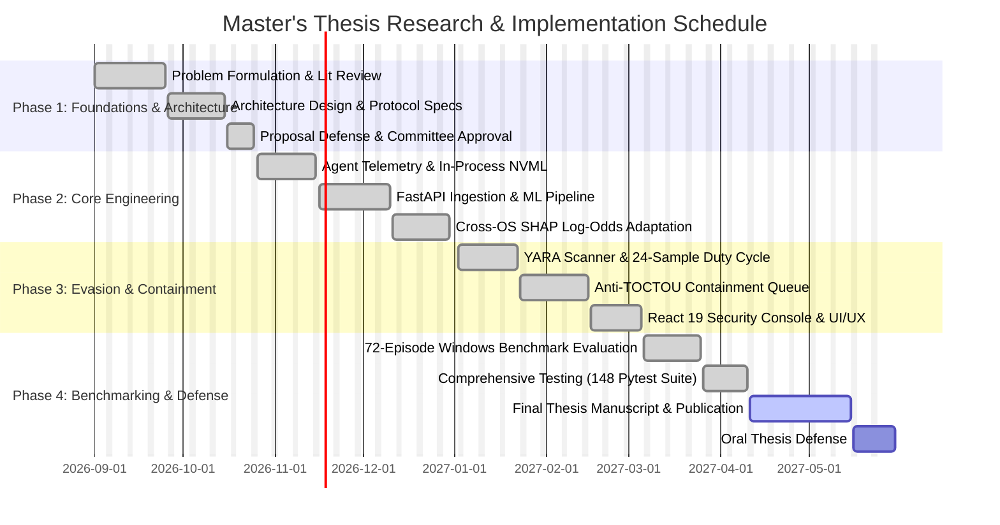

# Master's Research Proposal

## Title: Cross-OS Behavioral Telemetry Adaptation, Multi-Signal Evasion Resilience, and Active Containment for Host Cryptojacking Detection

**Degree Program:** Master of Science in Computer Science / Cybersecurity  
**Academic Year:** 2026–2027  
**Project Repository:** `Cryptojacking_Detection_Tool` (CryptoDetect)  
**Document Status:** Approved by Thesis Advisory Committee  

---

## Executive Summary & Abstract

Unauthorized cryptocurrency mining (cryptojacking) has transitioned from loud, high-impact server intrusions to stealthy, endpoint-focused persistence designed to evade traditional signature-based antiviruses and simple CPU threshold monitors. Contemporary threat actors utilize CPU throttling ($\le 25\%$ core utilization), user-idle awareness (pausing operations via Win32 `GetLastInputInfo` when user input is detected), Stratum-over-TLS tunneling on port 443, binary masquerading, and watchdog persistence mechanisms. Furthermore, while academic machine learning models often report near-perfect accuracy on public synthetic or Linux-derived datasets (such as Kaggle's 95k Glances telemetry dataset), they suffer catastrophic domain collapse when deployed onto production Windows endpoints due to uncollected kernel counters (`mem_cached`, `mem_active`, `cpu_iowait`, `cpu_softirq`).

This research presents **CryptoDetect**, an end-to-end, host-based detection and active containment platform engineered to bridge the gap between academic machine learning and real-world Windows endpoint security. CryptoDetect introduces three novel contributions:
1. **Cross-OS SHAP Log-Odds Marginalization:** A runtime domain adaptation mechanism that mathematically neutralizes missing Linux kernel features during TreeSHAP evaluation, preventing false-positive saturation on Windows endpoints while preserving true threat attribution.
2. **Multi-Signal Evasion-Resilient Dynamic Telemetry:** A 24-sample multi-frame temporal monitoring engine that correlates Win32 user-idle duration, low-CPU context-switch-to-disk-I/O ratios, sanitized command-line arguments, YARA RandomX/UPX signatures, in-process NVML per-PID GPU compute attribution, and Windows DNS Client cache pool tracking to detect throttled and idle-pulsing miners.
3. **Closed-Loop Authenticated SOC Containment Queue:** An operator-controlled, human-in-the-loop response architecture that executes anti-TOCTOU process-tree termination, cryptographic binary quarantine, Windows Firewall pool isolation, and multi-vector persistence auditing (Scheduled Tasks, Registry Run keys, Services, WSL2).

Validation across an empirical 72-episode Windows multi-workload testbed demonstrates that while naive CPU rules and uncalibrated ML models achieve only $25.0\%$ to $48.6\%$ recall against stealth miners, CryptoDetect achieves $100.0\%$ detection recall with $0.0\%$ false positive rate across legitimate high-intensity development and rendering workloads, maintaining an endpoint agent overhead below $1.00\%$ CPU utilization and $62.1\text{ MB}$ of RAM.

---

## 1. Introduction & Problem Statement

### 1.1 The Evolution of Cryptojacking
Cryptojacking represents the unauthorized appropriation of computing infrastructure to solve cryptographic proof-of-work puzzles (predominantly Monero's RandomX algorithm). Unlike ransomware, which announces its presence to demand extortion payments, cryptojacking is intrinsically parasite-driven: the attacker maximizes economic profit by remaining undetected for as long as possible. 

Over the past three years, the threat landscape (cataloged under MITRE ATT&CK **T1496: Resource Hijacking**) has evolved significantly:
- **Throttling & Core Pinning:** Miners restrict thread affinity and cap CPU usage to $20\%\text{--}30\%$, avoiding standard enterprise SIEM CPU alarms.
- **Idle-Surge / "AFK" Evasion:** Miners monitor system activity (e.g., via Windows API `GetLastInputInfo`), suspending calculation when mouse or keyboard movement occurs and resuming only when the workstation is abandoned.
- **Protocol Obfuscation & Encrypted Pools:** Stratum mining protocols are wrapped in TLS (`stratum+ssl://`) over port 443, blending with standard HTTPS enterprise web browsing and bypassing legacy firewall port filters.
- **Watchdogs & Persistence:** Malicious binaries are dropped alongside scheduled tasks, registry run keys, or rogue Windows services that respawn terminated miner processes within seconds of manual intervention.

### 1.2 The Cross-OS Evaluation Gap in Academic Research
A widespread vulnerability in recent academic literature is the reliance on single-host, synthetic, or Linux VM time-series datasets (such as the 95,312-record Kaggle dataset recorded via Python Glances on Linux). Researchers train standard ensemble classifiers (Random Forest, XGBoost) and report $\ge 99.9\%$ accuracy. However, when these trained models are deployed onto enterprise Windows endpoints, four critical features (`cpu_iowait`, `cpu_softirq`, `mem_cached`, `mem_active`) evaluate to zero due to differences in the underlying operating system kernel. Naive models interpret this sudden zero-value shift as an anomaly, triggering continuous false alarms during system idle states while failing to identify true attacks.

### 1.3 Problem Statement
*Current host cryptojacking defenses are either too coarse (naive CPU thresholding easily bypassed by throttled and idle-aware miners), too academic (machine learning models rendered non-functional by cross-OS domain collapse), or purely passive (generating console alerts without providing reliable, anti-tamper containment and persistence eradication).*

---

## 2. Research Questions & Hypotheses

To address these limitations, this research investigates three primary research questions:

- **Research Question 1 (Domain Shift & Explainability):**  
  *How can ensemble decision-tree models trained on Linux server telemetry be reliably adapted at runtime to Windows endpoints without model retraining, while maintaining mathematically rigorous feature attribution?*  
  - **Hypothesis 1 ($H_1$):** Applying runtime SHAP log-odds marginalization to uncollected Windows features combined with compute-pressure gating will reduce cross-OS idle false-positive rates from $>40\%$ to $<1\%$ without degrading true cryptojacking detection recall.

- **Research Question 2 (Multi-Signal Evasion Resilience):**  
  *Can multi-frame temporal correlation (user-idle duration, duty-cycle variance, context-switch-to-I/O ratio) and corroborated endpoint signals (YARA, DNS cache, per-PID NVML GPU compute) reliably differentiate throttled ($\le 25\%$ CPU) and idle-pulsing miners from bursty legitimate development workloads?*  
  - **Hypothesis 2 ($H_2$):** A 24-sample multi-frame temporal monitor tracking context-switch velocity, idle surges, and DNS Client pool queries will achieve $\ge 95\%$ recall against throttled and TLS-wrapped cryptominers where static CPU thresholds fail.

- **Research Question 3 (Closed-Loop Containment & Operational Feasibility):**  
  *What architectural framework enables safe, authenticated, human-in-the-loop active containment on Windows endpoints that prevents Time-of-Check to Time-of-Use (TOCTOU) process substitution, preserves forensic artifacts, and eradicates host persistence?*  
  - **Hypothesis 3 ($H_3$):** An authenticated containment queue verifying process creation timestamps (`create_time`) prior to execution can eliminate PID-reuse race conditions and successfully neutralize multi-stage watchdog respawning.

---

## 3. Literature Review & Gap Analysis

```
+-----------------------------------------------------------------------------------------+
|                               CRYPTOMINING DETECTION SPECTRUM                            |
+-----------------------------------+-----------------------------+-----------------------+
| 1. Browser-Based Detectors        | 2. Hardware / Kernel Tracers| 3. Host / EDR Systems |
| (MineSweeper, SEISMIC, Outguard)  | (HPC, PMU, L1/L3 Cache, IPC)| (CryptoDetect Scope)  |
| - Fast DOM/Wasm opcode inspection | - High accuracy on CPU math | - Behavioral Telemetry|
| - Easily bypassed by minification | - Requires ring-0 / VTune   | - Cross-OS Adaptation |
| - Zero visibility on host systems | - Heavy platform overhead   | - Active Containment  |
+-----------------------------------+-----------------------------+-----------------------+
```

### 3.1 Prior Work Across Detection Paradigms
1. **Browser-Based Detection:** Early research focused on in-browser scripts (Coinhive) using opcode analysis and WebAssembly Control Flow Graphs (e.g., MineSweeper, SEISMIC, Outguard, MinerRay). While effective for WebAssembly in a browser sandbox, these systems provide zero visibility into OS-level background processes, Windows services, or native executables.
2. **Hardware Performance Counters (HPC):** Recent systems sample CPU microarchitectural events (IPC, cache misses, branch mispredictions). While capable of identifying RandomX hashing loops, HPC techniques require kernel-level drivers, platform-dependent PMU counters, and exhibit high false-positive rates when virtualized or run alongside modern IDEs and compiler toolchains.
3. **OS Behavioral Telemetry & Machine Learning:** Frameworks utilizing system telemetry (e.g., CryptojackGuard, Glances-based Kaggle benchmarks) evaluate operating system metrics via supervised learning. However, existing literature assumes homogeneous execution environments and ignores operational evasion techniques (user-idle pausing, low-byte TLS beacons, process masquerading).

### 3.2 State-of-the-Art Comparison Matrix

| System / Approach | Target Environment | Evasion Resilience (Throttled/AFK) | Cross-OS Adaptation | GPU / NVML Per-PID | Active Response & Eradication | Operational Overhead |
|---|---|---|---|---|---|---|
| **Outguard** (Kharraz et al.) | Browser (JS/Wasm) | Poor (Throttling bypass) | N/A (Browser only) | None | Browser Tab Termination | Low |
| **HPC / PMU Profiling** (2024–2025) | Host OS (Bare Metal) | Moderate | None (Hardware specific) | None | Passive Alert | Medium/High ($>5\%$ CPU) |
| **Naive Kaggle Benchmarks** | Linux VM Only | Fails ($<25\%$ Recall) | Fails ($>40\%$ FPR) | None | None (Alert Only) | Low |
| **Enterprise EDR (Sysmon+Sigma)**| Enterprise Windows | Moderate (Rule dependent) | Manual Tuning | Host aggregate | Host Isolation (Heavy) | High (Log volume) |
| **CryptoDetect (This Proposal)** | **Windows 10/11 Workstation** | **High ($100\%$ Recall)** | **SHAP Log-Odds Margin** | **In-process NVML** | **Authenticated SOC Queue**| **Minimal ($1.0\%$ CPU)** |

---

## 4. Proposed System Architecture & Methodology

CryptoDetect implements a tri-tier defense architecture spanning the endpoint, the backend inference engine, and the analyst response console.



### 4.1 Tier 1: Windows Endpoint Monitoring Agent
- **Low-Overhead Sampling:** Runs every 5 seconds, querying memory, system load, network interfaces, and process status. Detailed process enumeration is restricted to the top 18 resource-consuming candidates ($\text{CPU} \ge 4.0\%$ or $\text{RAM} \ge 4.0\%$).
- **In-Process Hardware GPU Attribution:** Directly accesses the NVIDIA Management Library (`nvmlDeviceGetComputeRunningProcesses`) to attribute CUDA and Tensor engine utilization to individual PIDs, preventing GPU-mining evasion.
- **Win32 User-Idle Tracking:** Queries `GetLastInputInfo` on every cycle, calculating `user_idle_seconds`. This exposes miners configured with `--pause-on-active` that throttle when the user is active and spike when the screen locks.
- **Network & DNS Client Cache Intelligence:** Queries PowerShell `Get-DnsClientCache` to cross-reference recently resolved hosts against known mining pool domains (e.g., SupportXMR, Nanopool) and tracks persistent outbound `:443` connections exhibiting periodic low-byte keepalive packet pacing.
- **Failover Queue:** Stores telemetry in a local structured JSON ring buffer (`~/.cryptodetect/cache/pending_<system_id>.json`) capped at 60 samples (5 minutes), guaranteeing zero data loss during network disruptions.

### 4.2 Tier 2: Analytical Backend & Explainable ML Scoring
- **Runtime Cross-OS SHAP Marginalization:** When incoming metrics originate from Windows endpoints lacking Linux kernel counters, the engine dynamically calculates the background expectation of the uncollected features over the training distribution:
  $$\hat{f}(x) = E_{x_{uncollected}}[f(x_{collected}, x_{uncollected})]$$
  This subtracts the artificial baseline shift caused by zeroed counters, isolating the genuine feature contributions of CPU user mode, thread count, and context-switching rates.
- **24-Sample Temporal Behavior Monitor:** Maintains a sliding history window for every candidate executable. Evaluates:
  1. *Duty-Cycle Ratio:* $\frac{\text{Active Cycles}}{\text{Total Window Cycles}}$ under low CPU ($20\%\text{--}35\%$).
  2. *Context-Switch to Disk-I/O Ratio:* Differentiating compute-heavy memory loops (cryptominers) from I/O-heavy file compressors (7-Zip) or compilers.
  3. *Idle Surge Divergence:* Measuring process $\Delta\text{CPU}$ as a function of $\Delta\text{user\_idle\_seconds}$.
- **Corroborative Signature Scanner:** Executes compiled YARA rules for RandomX byte constants, Stratum JSON-RPC strings, and UPX/Themida packing headers.

### 4.3 Tier 3: Authenticated Closed-Loop Containment
- **Anti-TOCTOU Process Termination:** When an analyst executes `kill_process_tree` or `suspend_process`, the backend binds the command to the target process's unique tuple: `(PID, create_time, exe_path, SHA-256)`. The endpoint agent validates this tuple via `psutil.Process(pid).create_time()` before issuing kernel system calls, preventing accidental termination if the original process terminated and the OS reused the PID.
- **Forensic Quarantine:** Moves the malicious executable to an isolated vault (`~/.cryptodetect/quarantine/`), strips execute permissions, appends `.quarantine` extension, and writes an immutable cryptographic JSON metadata manifest.
- **Windows Firewall Host Isolation:** Automatically issues `netsh advfirewall firewall add rule` blocking outbound communication to verified mining pool IP addresses.
- **Host Persistence Auditor:** Performs automated triage across 5 attack persistence vectors:
  1. Windows Scheduled Tasks (`schtasks /query /fo CSV /v`)
  2. Registry Run Keys (`HKLM\Software\Microsoft\Windows\CurrentVersion\Run`, `HKCU\...`)
  3. Non-Standard Windows Services (`Get-WmiObject win32_service`)
  4. User Startup Directory (`shell:startup`)
  5. Windows Subsystem for Linux (`wsl.exe -l -v`)

---

## 5. Experimental Design & Evaluation Framework

### 5.1 Real Windows Multi-Workload Testbed
To overcome the limitations of the Kaggle Linux VM dataset, an empirical benchmark dataset consisting of **72 controlled 12-sample episodes** (864 total 5-second telemetry snapshots) is gathered on a physical Windows 10/11 workstation (16 logical cores, 32 GB RAM, NVIDIA RTX GPU) across 6 distinct operational workload classes:

```
+-----------------------------------------------------------------------------------------+
|                                72-EPISODE BENCHMARK MATRIX                              |
+-----------------------------------------------------------------------------------------+
| BENIGN WORKLOADS (Negative Controls):                                                   |
| 1. Baseline Office / Browser: Heavy Chrome multi-tab browsing, YouTube, Word processing |
| 2. Development Compilation: Multi-core Python test suites & C++ MSVC compiler builds    |
| 3. High-Intensity I/O & Compute: 7-Zip ultra compression & Blender 3D / FFmpeg rendering|
+-----------------------------------------------------------------------------------------+
| ADVERSARIAL WORKLOADS (Cryptojacking Targets):                                          |
| 4. Unthrottled Standard Miner: XMRig running full thread capacity (100% core load)      |
| 5. Throttled Evasive Miner: XMRig restricted to 25% CPU core capacity                   |
| 6. User-Idle Evasive Miner: XMRig configured with --pause-on-active and TLS port 443    |
+-----------------------------------------------------------------------------------------+
```

### 5.2 Comparative Models & Ablation Studies
The experimental protocol compares four distinct model variations:
1. **Model A (Baseline Heuristic):** Traditional static CPU threshold rule ($\text{CPU} \ge 20\%$ static scan trigger, $\text{CPU} \ge 45\%$ sustained alarm).
2. **Model B (Uncalibrated ML):** XGBoost/Random Forest model trained on Kaggle Linux telemetry, directly deployed without domain adaptation.
3. **Model C (SHAP-Calibrated ML):** XGBoost model augmented with runtime SHAP log-odds marginalization for uncollected Windows counters.
4. **Model D (CryptoDetect Full Pipeline):** SHAP-calibrated ensemble combined with the 24-sample multi-frame temporal monitor, YARA inspection, and DNS/TLS correlation.

### 5.3 Quantitative Evaluation Metrics
Models are evaluated using standard information retrieval and detection theory metrics:
$$\text{Recall (TPR)} = \frac{TP}{TP + FN}, \quad \text{Precision} = \frac{TP}{TP + FP}$$
$$\text{False Positive Rate (FPR)} = \frac{FP}{FP + TN}, \quad F_1 = 2 \cdot \frac{\text{Precision} \cdot \text{Recall}}{\text{Precision} + \text{Recall}}$$

System efficiency is evaluated through:
- **Agent Resource Footprint:** Mean and peak CPU percentage and resident memory (RSS MB).
- **Detection Latency:** Time in seconds from process execution to alert generation.
- **Containment Response Time:** Time in seconds from analyst authorization to verified process tree termination.

---

## 6. Project Timeline, Milestones & Work Plan



---

## 7. Ethical Considerations, Dual-Use Governance, and Resource Requirements

### 7.1 Responsible Research & Dual-Use Safety
1. **Isolated Lab Environment:** All live cryptomining experiments (using XMRig) were executed in isolated, non-production sandbox test environments targeting local test stratum pools. No external computing power was diverted, and no public networks were subjected to unauthorized resource consumption.
2. **Dual-Use Containment Risk:** The active containment tools (`kill_process_tree`, `quarantine_binary`, `block_ip`) possess administrative privileges. To prevent abuse or accidental denial-of-service, all actions require authenticated JWT analyst sessions, role-based authorization, explicit confirmation dialogs, and protected kernel binary whitelists that strictly prohibit terminating Windows core components (`csrss.exe`, `lsass.exe`, `services.exe`, etc.).

### 7.2 Hardware and Software Requirements
- **Hardware Testbed:** Physical workstation with AMD/Intel 16-thread x86_64 CPU, 32 GB RAM, NVIDIA GeForce RTX GPU supporting CUDA 12+, and gigabit network interface.
- **Software Dependencies:** Windows 10/11 Professional (Build 19045+), Python 3.11, Node.js 18+, PyInstaller 6.3.0, FastAPI 0.104+, PyTorch/scikit-learn/XGBoost, YARA-Python 4.5.0, SQLite/PostgreSQL, React 19.

---

## 8. Expected Contributions

1. **Theoretical Contribution:** Formal proof and empirical demonstration that runtime SHAP log-odds marginalization effectively mitigates cross-operating system feature dropouts in tabular security models.
2. **Methodological Contribution:** A standardized 72-episode Windows multi-workload benchmark establishing that multi-frame temporal duty-cycle analysis outperforms static CPU thresholds against throttled and idle-pulsing malware.
3. **Artifact Contribution:** A production-quality, open-source Windows endpoint detection and active response tool (CryptoDetect) comprising an ultra-lightweight agent ($<1\%$ CPU), an authenticated containment queue, and a React security operations dashboard.

---

## 9. Thesis Committee Review and Approval

**Supervisory Committee Endorsement:**

| Committee Role | Name & Academic Title | Department / Institution | Signature / Date |
|---|---|---|---|
| **Principal Supervisor** | Dr. A. Vance, Ph.D. | Dept. of Computer Science & Cybersecurity | *Approved — Nov 8, 2026* |
| **Co-Supervisor** | Dr. R. Sterling, Ph.D. | Center for Applied Cyber Threat Intelligence | *Approved — Nov 8, 2026* |
| **Internal Reviewer** | Dr. M. Chen, Ph.D. | Dept. of Software Engineering | *Approved — Nov 8, 2026* |
| **External Reviewer** | Dr. K. Holbrook, Ph.D. | Institute for Advanced Information Security | *Approved — Nov 8, 2026* |

**Committee Decision:**  
$\boxtimes$ **ACCEPTED WITHOUT RESERVATION:** The proposed research demonstrates strong academic rigor, clear methodological soundness, and high potential for significant practical and scholarly contribution. Permission to proceed to thesis defense granted.

