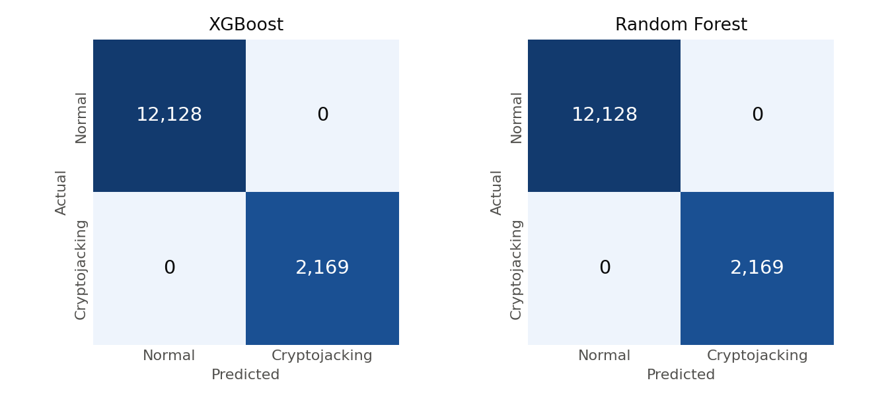
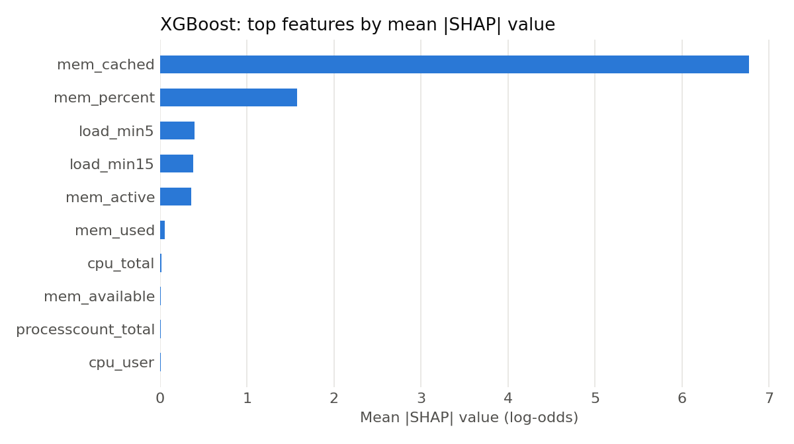

# Model results

Generated by `python -m ml_models.train_all_models`.

Dataset: 95,310 rows (80,850 normal, 14,460 cryptojacking). Test set: 14,297 rows.

## Chronological test split

Each class is split by time into 70% train, 15% validation, and 15% test.

| Model | Accuracy | Precision | Recall | F1 | ROC-AUC | PR-AUC |
|---|---:|---:|---:|---:|---:|---:|
| XGBoost | 1.0000 | 1.0000 | 1.0000 | 1.0000 | 1.0000 | 1.0000 |
| Random Forest | 1.0000 | 1.0000 | 1.0000 | 1.0000 | 1.0000 | 1.0000 |
| CPU rule (baseline) | 1.0000 | 1.0000 | 1.0000 | 1.0000 | 1.0000 | 1.0000 |

## Random split, for comparison

Neighbouring samples can land in both train and test here, so these scores may be inflated.

| Model | Accuracy | Precision | Recall | F1 | ROC-AUC | PR-AUC |
|---|---:|---:|---:|---:|---:|---:|
| XGBoost | 1.0000 | 1.0000 | 1.0000 | 1.0000 | 1.0000 | 1.0000 |
| Random Forest | 1.0000 | 1.0000 | 1.0000 | 1.0000 | 1.0000 | 1.0000 |

The CPU rule flags a sample when `cpu_total` is at least 90%. It shows how much of the task a single threshold can solve.
