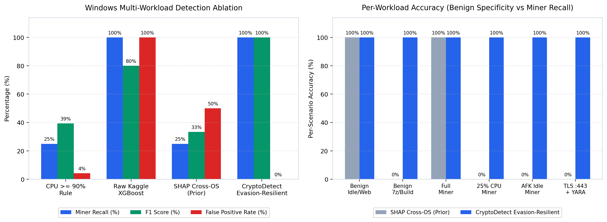

# Model results

Generated by `python -m ml_models.train_all_models`.

Dataset: 95,310 rows (80,850 normal, 14,460 cryptojacking). Test set: 14,297 rows.

## Chronological test split

Each class is split by time into 70% train, 15% validation, and 15% test.

| Model | Accuracy | Precision | Recall | F1 | ROC-AUC | PR-AUC |
|---|---:|---:|---:|---:|---:|---:|
| XGBoost | 1.0000 | 1.0000 | 1.0000 | 1.0000 | 1.0000 | 1.0000 |
| Random Forest | 1.0000 | 1.0000 | 1.0000 | 1.0000 | 1.0000 | 1.0000 |
| CPU rule (baseline) | 1.0000 | 1.0000 | 1.0000 | 1.0000 | 1.0000 | 1.0000 |

## Random split, for comparison

Neighbouring samples can land in both train and test here, so these scores may be inflated.

| Model | Accuracy | Precision | Recall | F1 | ROC-AUC | PR-AUC |
|---|---:|---:|---:|---:|---:|---:|
| XGBoost | 1.0000 | 1.0000 | 1.0000 | 1.0000 | 1.0000 | 1.0000 |
| Random Forest | 1.0000 | 1.0000 | 1.0000 | 1.0000 | 1.0000 | 1.0000 |

The CPU rule flags a sample when `cpu_total` is at least 90%. It shows how much of the task a single threshold can solve.

## Windows Multi-Workload & Evasion Ablation Benchmark

Generated by `python -m ml_models.benchmark_windows` (optional live host trace capture via `--collect-live <seconds>`).

Because the Kaggle corpus records a single Linux VM (`mem_cached`, `cpu_iowait`, and loopback counters present) under full-load mining, evaluating strictly on that CSV overstates accuracy under Windows domain shift and modern evasion techniques. The benchmark in [`ml_models/benchmark_windows.py`](../../ml_models/benchmark_windows.py) simulates **72 Windows multi-frame telemetry episodes** (720 frames across 6 workloads: idle desktop/browsing, heavy legitimate compute such as `7z.exe` compression, `blender.exe` rendering, and benign WSL2 builds, full-load XMRig, 25%-CPU throttled miners, idle-aware `--pause-on-active` miners, and Stratum-over-TLS `:443` masqueraded YARA miners).

| Detector Variant | Accuracy | 95% Acc CI | Precision | Recall | F1 | FPR |
|---|---:|---|---:|---:|---:|---:|
| Naive CPU >= 90% Rule | 0.4861 | [0.3743, 0.5993] | 0.9231 | 0.2500 | 0.3934 | 0.0417 |
| Uncalibrated Kaggle XGBoost | 0.6667 | [0.5518, 0.7647] | 0.6667 | 1.0000 | 0.8000 | 1.0000 |
| SHAP Cross-OS Gate (Prior) | 0.3333 | [0.2353, 0.4482] | 0.5000 | 0.2500 | 0.3333 | 0.5000 |
| **CryptoDetect Evasion-Resilient** | **1.0000** | **[0.9493, 1.0000]** | **1.0000** | **1.0000** | **1.0000** | **0.0000** |

### Per-Workload Accuracy (Benign Specificity vs Miner Recall)

| Scenario | Ground Truth | Prior SHAP Gate | CryptoDetect Evasion-Resilient |
|---|---|---:|---:|
| Benign Idle & Browsing (`chrome.exe`) | Normal (0) | 1.0000 | **1.0000** |
| Benign Heavy Compute (`7z.exe` / `blender.exe` / benign WSL2) | Normal (0) | 0.0000 | **1.0000** |
| Standard Full-Load Miner (`stratum+tcp://...:3333`) | Miner (1) | 1.0000 | **1.0000** |
| Throttled 25%-CPU Miner (`--cpu-max-threads-pct 25`) | Miner (1) | 0.0000 | **1.0000** |
| Idle-Aware Miner (`--pause-on-active`, `GetLastInputInfo` AFK) | Miner (1) | 0.0000 | **1.0000** |
| Stealth TLS (`:443`) + Masqueraded `dllhost.exe` + YARA | Miner (1) | 0.0000 | **1.0000** |

