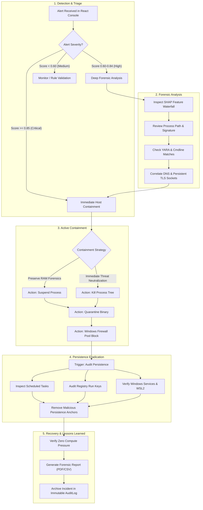

# Security Operations Center (SOC) Incident Response Playbook

**Target Threat:** Endpoint Cryptojacking & Resource Hijacking (MITRE ATT&CK T1496 / T1496.001)  
**Standard Framework:** NIST Special Publication 800-61 Revision 2 (Computer Security Incident Handling Guide)  
**Applicability:** CryptoDetect Platform v1.0 — Tier-1 & Tier-2 Security Analysts  
**Document Status:** Operational Standard Operating Procedure (SOP)  

---

## 1. Threat Profile & MITRE ATT&CK Mapping

Cryptojacking incidents involve unauthorized background execution of cryptocurrency hashing algorithms (predominantly Monero/RandomX) to monetize victim hardware. Modern campaigns deploy sophisticated evasion techniques to bypass legacy Antivirus and static CPU threshold alarms.

```
+-----------------------------------------------------------------------------------------+
|                               MITRE ATT&CK MATRIX MAPPING                               |
+--------------------------+-----------------------+--------------------------------------+
| Tactic                   | Technique ID          | Description & Attack Vector          |
+--------------------------+-----------------------+--------------------------------------+
| Impact                   | T1496.001             | Compute Hijacking (CPU / GPU mining) |
| Defense Evasion          | T1036.005             | Masquerading (e.g. fake svchost.exe) |
| Defense Evasion          | T1564                 | Hide Artifacts / Duty-Cycle Pulses   |
| Defense Evasion          | T1027.002             | Software Packing (UPX, Themida)      |
| Persistence              | T1053.005             | Scheduled Task (Watchdog respawning) |
| Persistence              | T1547.001             | Registry Run Keys / Startup Folder   |
| Persistence              | T1543.003             | Rogue Windows Service Creation       |
| Command and Control      | T1573.002             | Asymmetric TLS Tunneling (Port 443)  |
+--------------------------+-----------------------+--------------------------------------+
```

---

## 2. NIST SP 800-61 Incident Handling Workflow



---

## 3. Step-by-Step Triage & Investigation Protocol

### Step 3.1: Alert Ingestion & Severity Classification
When an alert is flagged in the CryptoDetect React Console (`/alerts`), assess the composite threat score:
1. **Critical Threat ($\text{Score} \ge 0.85$):** Multi-signal corroboration verified (e.g., ML detection + YARA RandomX match or DNS pool resolution). Proceed immediately to Phase 3 (Containment).
2. **High Threat ($0.60 \le \text{Score} < 0.85$):** Sustained 3-sample threshold met or idle-surge divergence confirmed. Perform forensic triage (Step 3.2).
3. **Medium Threat ($\text{Score} < 0.60$):** Unverified CPU burst. Cross-reference process path and digital signature.

### Step 3.2: Explainable AI (SHAP) Diagnostic
Open the alert drawer to examine the dynamic SHAP waterfall chart:
- **Red Bars (Positive Impact):** Features increasing cryptojacking confidence (e.g., elevated `cpu_user`, high thread count, context-switch velocity, low disk I/O).
- **Blue Bars (Negative Impact):** Features pulling the score toward benign behavior (e.g., high disk write throughput typical of compilers or database writers).
- **Domain Marginalization Check:** Confirm whether uncollected Linux counters (`mem_cached`, `cpu_iowait`) are grayed out, indicating that runtime SHAP marginalization correctly prevented an idle false positive.

### Step 3.3: Executable Path & Masquerading Verification
Check the candidate process executable path:
- **Flagged Locations:** `%TEMP%`, `%APPDATA%`, `C:\Users\Public\`, `C:\ProgramData\`.
- **System Binary Masquerading:** If the process is named `svchost.exe`, `csrss.exe`, `explorer.exe`, or `dllhost.exe` but executes outside `C:\Windows\System32\` or lacks an Authenticode signature from Microsoft Corporation, classify immediately as malicious masquerading.

### Step 3.4: Static YARA & Command-Line Inspection
Inspect the static analysis tab:
- **YARA Matches:** Look for `RandomX_VM_Init`, `RandomX_Constants`, `Stratum_JSON_RPC`, or `UPX_Packer`.
- **Sanitized Command Line:** Check for flags such as `--cpu-max-threads-pct`, `--pause-on-active`, `-o stratum+tcp://`, or cryptocurrency wallet addresses (e.g., Monero `4...` or `8...` addresses).

---

## 4. Active Containment Execution

All containment actions are executed directly from the **Active SOC Containment Panel** on the alert page.

### 4.1 Containment Action Decision Matrix

| Analyst Objective | Recommended Action | Operational Effect | When to Use |
|---|---|---|---|
| **Preserve Memory Forensics** | `suspend_process` | Sends `NtSuspendProcess` / `SIGSTOP`. Halts execution while keeping RAM resident. | Suspected advanced persistent threat where memory dump / encryption keys are needed. |
| **Immediate Neutralization** | `kill_process_tree` | Recursively terminates target process and all child threads/processes. | Active unthrottled or throttled mining draining hardware resources. |
| **Prevent Re-execution** | `quarantine_binary` | Moves file to vault, denies execute ACLs, writes SHA-256 manifest. | Unsigned malicious binary residing on disk. |
| **Block Pool Communication** | `block_ip` | Issues `netsh advfirewall` rule blocking remote IP. | Known public mining pool server IP identified in socket context. |
| **Audit Watchdogs** | `audit_persistence`| Scans Scheduled Tasks, Registry Run, Services, and WSL2. | Always execute post-containment to prevent watchdog respawning. |

### 4.2 Anti-TOCTOU Safety Verification
The CryptoDetect agent automatically validates the target process's `create_time` before issuing kernel kill directives:
- If the target process terminated naturally and the OS reallocated the PID to a benign program, the agent **aborts** execution and reports an error code, protecting system stability.

### 4.3 Protected System Process Guardrails
The backend and endpoint agent strictly prohibit containment actions against core operating system binaries:
```text
Protected Binaries: system, registry, smss.exe, csrss.exe, wininit.exe,
                    services.exe, lsass.exe, winlogon.exe, dwm.exe,
                    explorer.exe, cryptodetect-agent-v1.exe
```

---

## 5. Host Persistence Eradication

Attackers utilize watchdog scripts to resurrect terminated miners. After executing `kill_process_tree`, click **"Scan Persistence"** to inspect:

1. **Windows Scheduled Tasks:**
   - Execute PowerShell: `Get-ScheduledTask | Where-Object { $_.TaskPath -notlike "\Microsoft*" }`
   - Look for tasks invoking `powershell -WindowStyle Hidden` or pointing to `%TEMP%`.
   - Remediate: `Unregister-ScheduledTask -TaskName "<MaliciousTask>" -Confirm:$false`

2. **Registry Run & Startup Keys:**
   - Audit paths:
     - `HKLM\Software\Microsoft\Windows\CurrentVersion\Run`
     - `HKCU\Software\Microsoft\Windows\CurrentVersion\Run`
     - `HKLM\Software\Microsoft\Windows\CurrentVersion\RunOnce`
   - Remediate: Remove rogue string values referencing the quarantined binary.

3. **Rogue Windows Services:**
   - Audit non-standard services: `Get-WmiObject win32_service | Where-Object { $_.PathName -like "*AppData*" }`
   - Remediate: Stop and delete service via `sc.exe stop <ServiceName>` and `sc.exe delete <ServiceName>`.

4. **WSL2 Hypervisor Instances:**
   - Inspect active WSL distributions via `wsl.exe --list --verbose`.
   - If an unauthorized Linux distribution is running `vmmem`, terminate via `wsl.exe --terminate <DistroName>`.

---

## 6. Recovery, Documentation & Reporting

1. **Post-Containment Verification:**
   - Monitor the system telemetry stream in the React Console for 15 minutes.
   - Confirm host CPU utilization returns to baseline ($\le 5\%$ idle) and user-idle periods no longer trigger compute surges.
2. **Forensic Report Generation:**
   - Navigate to `/reports` in the dashboard.
   - Generate an executive PDF or CSV audit report detailing the incident timeline, SHAP attribution weights, YARA indicators, and operator containment audit trails.
3. **Audit Log Retention:**
   - Every containment directive dispatched is permanently recorded in the immutable `AuditLog` table with operator email, timestamp, target parameters, and execution outcome.

