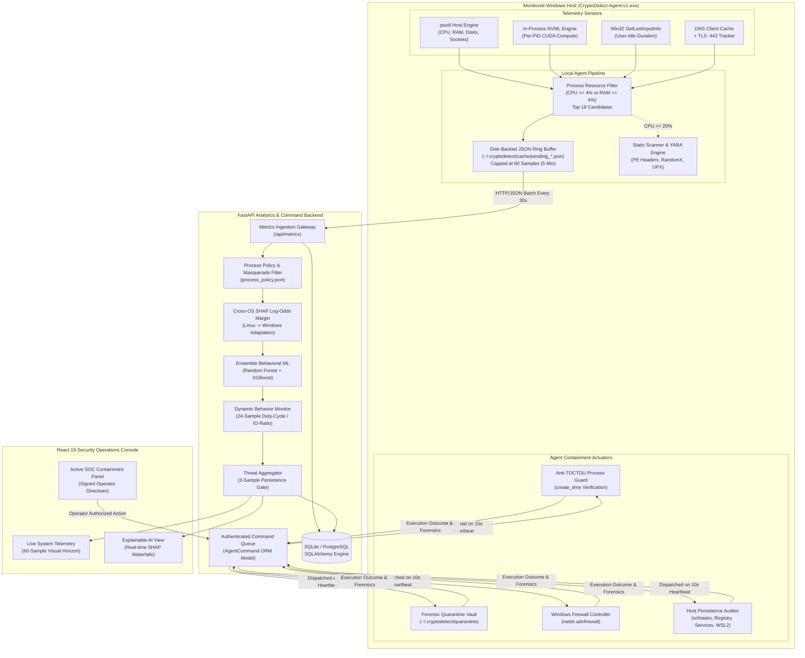
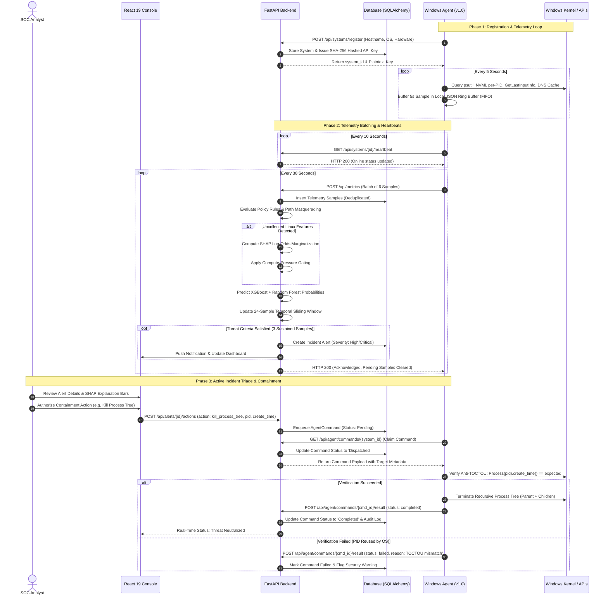
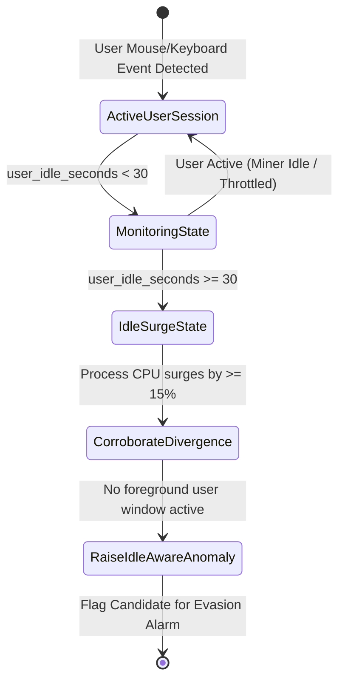
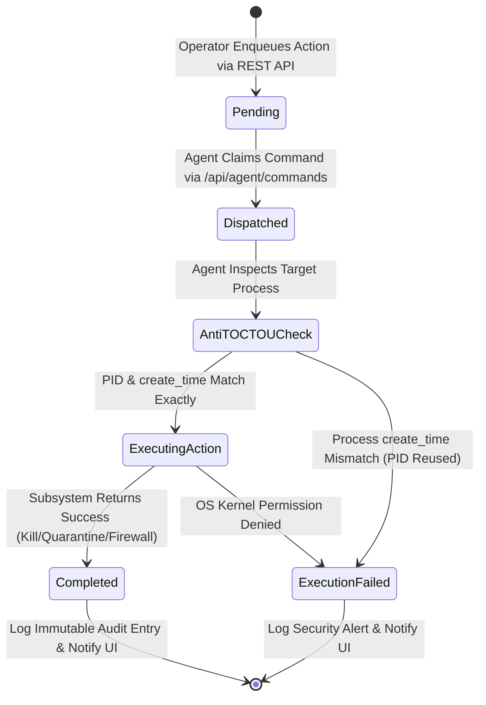

# CryptoDetect System Architecture & Technical Workflow Specification

**System Version:** v1.0  
**Target Environment:** Windows 10/11 Workstations (Endpoint) & Cross-Platform Linux/Windows Server (Backend)  
**Document Classification:** Engineering Design & Workflow Specification  

---

## 1. High-Level Architectural Overview

CryptoDetect implements a zero-trust, defense-in-depth endpoint security architecture structured across four decoupled tiers:

```
+--------------------------------------------------------------------------------------------------+
|                                    CRYPTODETECT TIERED TOPOLOGY                                   |
+------------------------------------+------------------------------------+------------------------+
| 1. Endpoint Sensor & Actuator Tier | 2. Ingestion & Analytics Tier      | 3. Security Analyst UI |
| (CryptoDetect-Agent-v1.exe)        | (FastAPI, SQLAlchemy, ML, SHAP)    | (React 19 Security Web)|
| - 5s In-Process NVML & psutil      | - Dynamic Cross-OS Feature Adapt.  | - Live Metrics Horizon |
| - Win32 User-Idle Tracking         | - 24-Sample Duty-Cycle Evaluation  | - SHAP Attribution Bars|
| - 60-Sample Outage Buffer          | - XGBoost & Random Forest Ensemble | - Active Containment   |
| - Anti-TOCTOU Command Executor     | - Authenticated Command Queue      | - Persistence Triage   |
+------------------------------------+------------------------------------+------------------------+
```

---

## 2. Component Architecture Diagram

The component diagram below visualizes the physical separation between sensor data collection, analytical processing, and operator response:



---

## 3. End-to-End Operational Lifecycle Sequence

The sequence diagram illustrates the communication flow across agent startup, telemetry streaming, multi-signal inference, alert generation, and containment dispatch:



---

## 4. Evasion Detection Subsystems

### 4.1 Win32 `GetLastInputInfo` Idle-Surge Correlation
Miners implementing `--pause-on-active` or duty-cycling evade static rules by halting calculation when user activity is detected. The endpoint agent samples:
$$\text{user\_idle\_seconds} = \frac{\text{GetTickCount}() - \text{GetLastInputInfo.dwTime}}{1000}$$



### 4.2 24-Sample Temporal Duty-Cycle & Context-Switch/I/O Tracking
To distinguish sustained, throttled miners ($20\%\text{--}35\%$ CPU) from legitimate bursty development tools (compilers, code indexers, test runners), the `DynamicBehaviorMonitor` maintains a 24-sample sliding history (representing a 2-minute time horizon):
1. **Duty-Cycle Score:**
   $$\text{DutyCycle} = \frac{\sum_{i=1}^{N} \mathbb{I}(\text{CPU}_i \ge 15.0\%)}{N}$$
   Where miners exhibit $\text{DutyCycle} \ge 0.80$ with extremely low variance ($\sigma_{\text{CPU}} \le 4.5\%$).
2. **Context-Switch to Disk-I/O Ratio:**
   $$\text{ComputePurityRatio} = \frac{\Delta\text{ContextSwitches}}{\Delta\text{DiskReadBytes} + \Delta\text{DiskWriteBytes} + 1}$$
   Cryptominers spend $>99\%$ of CPU cycles cycling in RAM hashing buffers without reading/writing disk files, whereas compilers and archivers (7-Zip) maintain heavy disk read/write throughput.

### 4.3 Encrypted Stratum-over-TLS (:443) & DNS Pool Tracking
Attackers frequently run miners with `--tls` on port 443, bypassing cleartext port monitors (`3333`, `4444`, `14444`). CryptoDetect correlates three signals:
1. **DNS Client Cache Inspection:** Queries PowerShell `Get-DnsClientCache` to extract recently resolved domains matching known pool lists (e.g., `*.supportxmr.com`, `*.nanopool.org`, `*.minexmr.com`).
2. **Persistent Sockets:** Flags processes maintaining active outbound connections to remote port 443 with connection lifetimes exceeding 60 seconds that are **not** attributed to known web browsers or signed software.
3. **Paced Low-Byte Flows:** Tracks periodic bidirectional payload transfers characteristic of Stratum JSON-RPC job submissions ($100\text{--}500\text{ bytes}$ per packet with fixed keepalive intervals).

### 4.4 In-Process NVML GPU Attribution
Standard OS monitors track only aggregate GPU load. The CryptoDetect agent utilizes Python NVML bindings (`pynvml`) in-process:
1. Resolves all active CUDA compute engines via `nvmlDeviceGetComputeRunningProcesses`.
2. Binds memory footprint and compute engine utilization directly to candidate PIDs.
3. Automatically triggers high-priority alerts if an unsigned binary running out of `%TEMP%` or `%APPDATA%` consumes $>100\text{ MB}$ of VRAM.

---

## 5. Authenticated Closed-Loop Containment Engine

### 5.1 Agent Command State Machine



### 5.2 Anti-TOCTOU Safeguards
To prevent Time-of-Check to Time-of-Use race conditions where a killed malicious process is replaced by an innocent application that happened to receive the same PID from the Windows kernel:
```python
# Verification Logic in monitoring_agent/enhanced_agent.py
def _verify_target_process(self, pid, expected_create_time=None, expected_name=None):
    if not psutil.pid_exists(pid):
        return False, "PID no longer exists"
    proc = psutil.Process(pid)
    if expected_create_time is not None:
        if abs(proc.create_time() - float(expected_create_time)) > 0.5:
            return False, "Process create_time mismatch (PID reallocated by OS)"
    if expected_name is not None:
        if proc.name().lower() != expected_name.lower():
            return False, "Process name mismatch"
    return True, proc
```

### 5.3 Quarantine Vault Architecture
When `quarantine_binary` executes:
1. **File Move:** Relocates binary from target directory to `~/.cryptodetect/quarantine/<sha256>.quarantine`.
2. **ACL Stripping:** Removes execute permissions (`icacls <file> /deny Everyone:(X)`).
3. **Forensic Manifest:** Writes `<sha256>.json` containing original path, file size, SHA-256 digest, isolation timestamp, and parent process command line.

### 5.4 Windows Host Persistence Auditor
Triggered on demand or automatically post-containment, scanning five operational vectors:
- **Scheduled Tasks:** Queries `schtasks /query /fo CSV /v` for tasks referencing unsigned binaries or invoking hidden PowerShell commands (`-WindowStyle Hidden -EncodedCommand`).
- **Registry Run Keys:** Enumerates `HKLM\Software\Microsoft\Windows\CurrentVersion\Run` and `HKCU\...`.
- **Windows Services:** Queries `win32_service` via WMI for services configured with `Automatic` start whose binary path resides outside `%SystemRoot%\System32`.
- **Startup Directory:** Audits `.lnk` shortcuts and `.bat` files in `%APPDATA%\Microsoft\Windows\Start Menu\Programs\Startup`.
- **WSL2 Hypervisor:** Inspects running distributions via `wsl.exe -l -v` to ensure attackers are not executing Linux miners inside `vmmem`.

---

## 6. Technical Data Schemas

### 6.1 Telemetry Metric Payload (`/api/metrics`)
```json
{
  "system_id": "SYS-9B21FA4E",
  "timestamp": "2026-11-08T15:30:00Z",
  "metrics": {
    "cpu_percent": 34.2,
    "memory_percent": 58.1,
    "load_min1": 2.75,
    "load_min5": 2.10,
    "load_min15": 1.95,
    "user_idle_seconds": 142.5,
    "active_process_count": 218,
    "gpu_metrics": {
      "available": true,
      "gpu_count": 1,
      "gpu_utilization": 88.0,
      "gpu_memory_used_mb": 2048,
      "compute_processes": [
        {"pid": 14208, "process_name": "xmrig.exe", "used_memory_mb": 1850}
      ]
    },
    "dns_miner_pool_detected": true,
    "top_processes": [
      {
        "pid": 14208,
        "name": "xmrig.exe",
        "cpu_percent": 24.8,
        "memory_percent": 4.2,
        "create_time": 1794129000.12,
        "exe_path": "C:\\Users\\Public\\xmrig.exe",
        "exe_hash": "e3b0c44298fc1c149afbf4c8996fb92427ae41e4649b934ca495991b7852b855",
        "cmdline": "--cpu-max-threads-pct 25 --pause-on-active -o stratum+ssl://pool.supportxmr.com:443",
        "has_miner_port": false,
        "has_stealth_tls": true,
        "idle_surge_divergence": true,
        "yara_matches": ["RandomX_VM_Init", "Stratum_JSON_RPC"]
      }
    ]
  }
}
```

### 6.2 Containment Action Payload (`/api/alerts/{id}/actions`)
```json
{
  "action": "kill_process_tree",
  "pid": 14208,
  "create_time": 1794129000.12,
  "process_name": "xmrig.exe",
  "exe_path": "C:\\Users\\Public\\xmrig.exe",
  "exe_hash": "e3b0c44298fc1c149afbf4c8996fb92427ae41e4649b934ca495991b7852b855",
  "remote_ip": "198.51.100.42"
}
```

